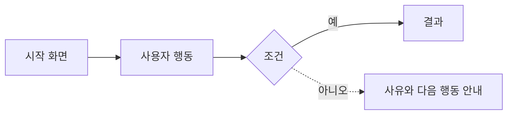

# (기능 이름)

<!--
노션 '기능 기획서' DB의 '[템플릿] 기능 기획서' 행과 같은 형식입니다. 형식을 바꾸면 노션 템플릿 행과 이 파일을 함께 고칩니다.
노션 속성: ID(FS-n, 자동), 상태, 담당, 검토자, 영역, 우선순위, 마일스톤, 성공 기준(SC-n), 화면, ADR, GitHub 이슈, 결정, 수용 기준 통과
-->

## 1. 한 줄 요약

이 기능이 끝나면 누가 무엇을 할 수 있는지 한 문장.

## 2. 왜 하나

- 문제:
- 근거: 성공 기준 SC-_ · 사용자 시나리오 · 결정 로그 항목
- 하지 않으면:

## 3. 사용자 이야기

- (사용자)로서, (목적)을 위해, (행동)하고 싶다.

## 4. 범위

- 포함:
- 제외(이번에 하지 않음):

## 5. 요구사항

| ID | 요구사항 | 꼭? | 비고 |
| --- | --- | --- | --- |
| R1 |  | 필수 |  |
| R2 |  | 있으면 좋음 |  |

## 6. 수용 기준

| ID | 이런 상황에서 | 이렇게 하면 | 이렇게 된다 | 관련 R |
| --- | --- | --- | --- | --- |
| AC1 |  |  |  | R1 |
| AC2 | (예외) |  |  | R1 |

## 7. 사용자 흐름

전체 서비스 흐름에서의 위치: (와이어프레임 페이지 흐름도의 단계)

## 8. 화면

새 화면은 Figma 파일에 바로 그리고, 와이어프레임 페이지 목록에 W-nn과 프레임 링크만 더합니다.

| 화면 | 무엇을 하는 화면 | 와이어프레임 | 시안(Figma) | 그린 상태 |
| --- | --- | --- | --- | --- |
| W-__ |  |  |  | 로딩 / 빈 화면 / 오류 / 제한 |

## 9. 설계·결정

- 구조 결정(ADR): 없음 / ADR-____
- API·DB 변경: 없음 / `docs/api-spec.md`의 ___, `docs/erd.md`의 ___
- 결정 로그:
- 열린 질문:

## 10. 작업 쪼개기

확정된 뒤에 채웁니다. 이슈 하나는 1~3일 작업이고, 마일스톤은 P1 이슈에만 붙입니다.

| WBS ID | 이슈 | 영역 | 다루는 AC | 선행 |
| --- | --- | --- | --- | --- |
|  | # |  | AC1, AC2 |  |

## 11. 검증·완료

결과: ✅ 자동 테스트 · ✅ 화면 확인 · ❌ 실패 · ⏳ 확인 전. API 테스트만 있으면 '(화면 확인 전)'을 붙입니다.

| AC | 결과 | 증빙(테스트·PR·화면·접수번호) | 확인한 사람·날짜 |
| --- | --- | --- | --- |
| AC1 | ⏳ 확인 전 |  |  |

- SC 기여:
- 남은 일:

## 12. 변경 이력

- YYYY-MM-DD: 처음 작성
