# ERD

> 스키마를 바꾸는 PR(Flyway 마이그레이션 추가)에서 이 문서도 함께 고칩니다. 문서와 마이그레이션 파일이 다르면 마이그레이션 파일(`backend/src/main/resources/db/migration`)이 기준입니다.

## 문서 정보

| 항목 | 내용 |
| --- | --- |
| 상태 | 초안 (M1 확정, M2 진행 중: 원문 구조화·문장 변경·요약 확정) |
| 담당 | 백엔드 |
| 마지막 수정 | 2026-10-26 |
| 관련 문서 | API 명세(`docs/api-spec.md`), [OpenDART 데이터 가이드](https://app.notion.com/p/400b6afffc6f81cc8870ee13d02d8ac1), 이슈 #46 |

## 1. 테이블 목록

| 테이블 | 설명 | 만드는 이슈 | 마일스톤 |
| --- | --- | --- | --- |
| `app_user` | 공통 회원 | #136 | 미정 |
| `local_credential` | 일반 가입 정보 | #136 | 미정 |
| `refresh_token` | 일반 로그인 Refresh Token 해시·회전 기록 | 6.2 | 미정 |
| `social_account` | Google·Kakao·Naver 계정과 공통 회원 연결 | #225 (6.3) | 미정 |
| `favorite_company` | 회원별 관심 기업 | #36 (6.2) | 미정 |
| `company` | 기업. OpenDART 고유번호 기준 | 4.4 (#51) | M1 |
| `company_overview` | 기업 개황(OpenDART `company.json`) 캐시. 고유번호 기준, 받은 시각으로 다시 받음 | 1.2 (#329) | M2 |
| `report` | 정기보고서. 접수번호 기준 | 4.1 (#27) | M1 |
| `financial_statement_fetch` | 재무제표 API를 부른 기록(보고서·연결/별도 단위) | 4.5 (#52) | M1 |
| `financial_account` | 재무제표 계정 값(API 응답 한 줄) | 4.5 (#52) | M1 |
| `report_key_account_fetch` | 보고서별 주요계정 API를 부른 기록(접수번호 단위) | 1.2 (#330) | M2 |
| `report_key_account` | 보고서별 주요계정 값(연결·별도, 계정 키 단위) | 1.2 (#330) | M2 |
| `company_disclosure_fetch` | 기업별 최근 공시 목록을 받은 기록(받은 시각·받은 기간) | 1.2 (#332) | M2 |
| `company_disclosure` | 받아 둔 최근 공시 한 건(공시검색 응답 한 줄) | 1.2 (#332) | M2 |
| `disclosure_key_item` | 주요사항보고서 한 건의 핵심 수치(OpenDART 주요사항보고서 주요정보) 받은 결과. 접수번호 기준 캐시 | 1.2 (#363, FS-51) | M2 |
| `analysis` | 분석 작업과 상태 | 4.3 (#29), 2.3 (#14) | M1 |
| `financial_change` | 계정별 비교 결과와 근거 | 2.4 (#15), 4.3 (#29) | M1 |
| `report_document` | 보고서 원문 구조화 기록(상태·파서 버전·경고) | 4.2 (#28) | M2 |
| `document_section` | 원문 목차(섹션) | 4.2 (#28) | M2 |
| `document_block` | 원문 문단·표와 위치 | 4.2 (#28) | M2 |
| `text_change` | 두 보고서의 문장·표 변경과 위치, 확인 우선순위 | 2.5 (#16), 2.6 (#17) | M2 |
| `summary_item` | 근거 기반 요약 한 줄(사실 문장, AI 문장, 근거 ID, 모델·프롬프트 버전) | 3.2 (#20) | M2 |
| `llm_call` | LLM 호출 기록(모델·토큰·지연·결과). 비용 집계 | 0.7 (#50), 3.2 (#20) | M2 |
| `analysis_question` | 분석에 한 질문과 AI 답(상태·근거 ID·사실·모델·프롬프트 버전), 답 평가(3.12) | 3.10 (#219), 3.12 (#236) | M2 |
| `text_change_explanation` | 문장 변경 하나의 AI 한 줄 풀이(상태·근거 ID·모델·프롬프트 버전) | 3.11 (#227) | M2 |
| `report_key_fact` | 보고서별 정기보고서 주요정보(최대주주·임원·배당) 받은 결과. 접수번호·종류 기준 캐시 | #331 (1.2, FS-47) | M2 |
| `company_briefing` | 보고서 하나의 AI 기업 브리핑(상태·문장과 근거·모델·프롬프트 버전) | 1.2 (#333) | M2 |
| `company_question` | 기업의 최신 사업보고서에 한 질문과 AI 답(상태·근거 ID·모델·프롬프트 버전) | 1.2 (#365) | M2 |

## 2. 관계도

```mermaid
erDiagram
    app_user ||--o| local_credential : "user_id (#136)"
    app_user ||--o{ refresh_token : "user_id (6.2)"
    app_user ||--o{ social_account : "user_id (6.3)"
    app_user ||--o{ favorite_company : "user_id (#36)"
    company ||--o{ favorite_company : "corp_code (#36)"
    app_user {
        bigint id PK
        datetime created_at
        datetime updated_at
    }
    local_credential {
        bigint id PK
        bigint user_id FK,UK
        varchar email UK
        varchar password_hash
        boolean email_verified
    }
    refresh_token {
        bigint id PK
        bigint user_id FK
        varchar token_hash UK
        varchar family_id
        datetime expires_at
        datetime revoked_at
        bigint replaced_by_id FK
    }
    social_account {
        bigint id PK
        bigint user_id FK
        varchar provider UK
        varchar provider_user_id UK
        varchar email
        boolean email_verified
    }
    favorite_company {
        bigint id PK
        bigint user_id FK
        varchar corp_code FK
        datetime created_at
    }
    company ||--o{ report : "corp_code"
    company ||--o| company_overview : "corp_code"
    company ||--o{ financial_statement_fetch : "corp_code"
    company ||--o| company_disclosure_fetch : "corp_code"
    company ||--o{ company_disclosure : "corp_code"
    company_disclosure ||--o| disclosure_key_item : "rcept_no (외래 키 없음, #363)"
    financial_statement_fetch ||--o{ financial_account : "fetch_id"
    report ||--o| report_key_account_fetch : "rcept_no"
    report ||--o{ report_key_account : "rcept_no"
    company ||--o{ analysis : "corp_code"
    report ||--o{ analysis : "current_rcept_no / previous_rcept_no"
    analysis ||--o{ financial_change : "analysis_id"
    analysis ||--o{ text_change : "analysis_id"
    analysis ||--o{ summary_item : "analysis_id"
    financial_change ||--o{ summary_item : "financial_change_id"
    analysis ||--o{ llm_call : "analysis_id"
    analysis ||--o{ analysis_question : "analysis_id"
    analysis ||--o{ text_change_explanation : "analysis_id"
    report ||--o| report_document : "rcept_no"
    report ||--o{ report_key_fact : "rcept_no (#331)"
    report_document ||--o{ document_section : "document_id"
    report_document ||--o{ document_block : "document_id"

    company {
        bigint id PK
        varchar corp_code UK "고유번호 8자리"
        varchar corp_name "회사명"
        varchar corp_name_key "검색용: 공백 뺀 소문자 회사명"
        varchar corp_name_chosung "검색용: 회사명 초성"
        varchar stock_code "종목코드, 상장사만"
        datetime reports_fetched_at "보고서 목록을 받은 시각"
    }
    company_overview {
        bigint id PK
        varchar corp_code UK,FK "고유번호"
        varchar status "OK NO_DATA"
        varchar ceo_nm "대표자명"
        varchar corp_cls "법인구분 Y K N E"
        date est_dt "설립일"
        datetime fetched_at "OpenDART에서 받은 시각"
    }
    report {
        bigint id PK
        varchar rcept_no UK "접수번호 14자리"
        varchar corp_code FK
        varchar report_type "ANNUAL HALF Q1 Q3"
        int fiscal_year "사업연도"
        date period_end "대상 기간 끝"
        date rcept_dt "접수일"
        varchar correction "ORIGINAL CORRECTED UNKNOWN"
        datetime last_seen_at "최신 목록에서 본 시각"
    }
    financial_statement_fetch {
        bigint id PK
        varchar corp_code FK
        int fiscal_year
        varchar reprt_code "11011 11012 11013 11014"
        varchar fs_div "CFS OFS"
        varchar status "OK NO_DATA"
    }
    financial_account {
        bigint id PK
        bigint fetch_id FK
        varchar rcept_no "근거 보고서"
        varchar sj_div "BS IS CIS CF SCE"
        varchar account_id "표준계정코드"
        bigint thstrm_amount "당기 금액"
    }
    report_key_account_fetch {
        bigint id PK
        varchar rcept_no UK,FK
        varchar status "OK NO_DATA"
        varchar source_rcept_no "응답의 접수번호"
        datetime fetched_at
    }
    report_key_account {
        bigint id PK
        varchar rcept_no FK
        varchar fs_div "CFS OFS"
        varchar account_key "REVENUE OPERATING_INCOME ..."
        bigint amount "당기 금액"
        bigint cumulative_amount "당기 누적 금액"
    }
    analysis {
        bigint id PK
        varchar corp_code FK
        varchar current_rcept_no FK
        varchar previous_rcept_no FK
        varchar basis "YOY PREV CUSTOM"
        varchar status "PENDING RUNNING COMPLETED FAILED"
        varchar step "RECEIVED COMPARING VERIFYING DONE"
    }
    financial_change {
        bigint id PK
        bigint analysis_id FK
        varchar sj_div
        varchar account_key
        bigint previous_amount
        bigint current_amount
        bigint change_amount
        decimal change_rate
        varchar calc_status
    }
    text_change {
        bigint id PK
        bigint analysis_id FK
        int change_no "문서 순서"
        varchar change_type "ADDED DELETED MODIFIED NUMERIC_UPDATE MOVED REVIEW_NEEDED"
        varchar priority "HIGH MEDIUM LOW UNRANKED"
        int previous_block_no
        int current_block_no
    }
    summary_item {
        bigint id PK
        bigint analysis_id FK
        int item_no
        varchar kind "FINANCIAL TEXT"
        varchar status "SHOWN REVIEW_NEEDED"
        varchar ai_text "AI 생성 문장"
        varchar evidence_ids "근거 ID 목록"
    }
    company_briefing ||--o{ llm_call : "company_briefing_id (#333)"
    company_question ||--o{ llm_call : "company_question_id (#365)"
    company_question {
        bigint id PK
        varchar rcept_no FK
        varchar question
        varchar status "ANSWERED NOT_FOUND OUT_OF_SCOPE REVIEW_NEEDED"
        varchar evidence_ids "근거 ID 목록"
    }
    company_briefing {
        bigint id PK
        varchar rcept_no FK "UK(rcept_no, prompt_version)"
        varchar prompt_version
        varchar status "GENERATED REVIEW_NEEDED"
        mediumtext sentences "문장·근거 JSON"
    }
    llm_call {
        bigint id PK
        bigint analysis_id FK "브리핑이면 null"
        bigint company_briefing_id FK
        bigint company_question_id FK
        varchar model
        varchar prompt_version
        int input_tokens
        varchar outcome
    }
    report_key_fact {
        bigint id PK
        varchar rcept_no FK "UK(rcept_no, kind)"
        varchar kind "MAJOR_SHAREHOLDERS EXECUTIVES DIVIDENDS"
        varchar status "OK NO_DATA"
        varchar source_rcept_no "값을 받은 공시(정정본)"
        mediumtext rows_json
    }
    company_disclosure_fetch {
        bigint id PK
        varchar corp_code FK,UK
        date covered_from "받은 기간 시작"
        date covered_to "받은 기간 끝"
        datetime fetched_at "받은 시각"
    }
    company_disclosure {
        bigint id PK
        varchar corp_code FK,UK
        varchar rcept_no UK "접수번호"
        varchar report_name
        date rcept_dt "접수일"
    }
    disclosure_key_item {
        bigint id PK
        varchar rcept_no UK "접수번호"
        varchar kind "CAPITAL_INCREASE 등"
        varchar status "OK NO_DATA"
        mediumtext items_json
        datetime fetched_at
    }
    report_document {
        bigint id PK
        varchar rcept_no FK "UK"
        varchar status "STRUCTURED PARTIAL FAILED NOT_AVAILABLE"
        varchar parser_version
    }
    document_section {
        bigint id PK
        bigint document_id FK
        int section_no "문서 순서"
        int parent_no
        varchar title
    }
    document_block {
        bigint id PK
        bigint document_id FK
        int block_no "근거 ID의 기준"
        int section_no
        varchar block_type "PARAGRAPH TABLE"
        mediumtext content
    }
```

## 3. 테이블 상세

공통: 모든 테이블의 기본키는 자동 증가 `id`(`BIGINT AUTO_INCREMENT`)입니다([ADR-0017](adr/0017-auto-increment-id-primary-key.md)). OpenDART에서 받은 키(고유번호·접수번호)는 UNIQUE로 두고, 다른 테이블은 이 값을 외래 키로 참조합니다. 문자열 키는 `VARCHAR`(앞자리 0을 지키기 위해 숫자형을 쓰지 않음), 금액은 보고서 통화의 정수 `BIGINT`(통화는 `currency` 컬럼), 시각은 `DATETIME(6)`(한국 시간), 상태 값은 `VARCHAR`에 영문 대문자로 저장합니다.

### company

OpenDART `corpCode.xml`에서 받습니다(4.4).

검색용 두 컬럼은 `corp_name`에서 backend가 계산해 채웁니다. 기업 목록을 넣거나 회사명이 바뀌면 함께 바꾸고, 이 컬럼이 생기기 전에 받아 둔 행(값이 null)은 서버가 시작할 때 일괄로 채웁니다. 그래서 null은 '아직 채우지 않음'이라는 뜻이고, 채운 뒤에는 null이 남지 않습니다.

| 컬럼 | 타입 | 키 | null | 설명 |
| --- | --- | --- | --- | --- |
| `id` | BIGINT | PK | 아니오 | 자동 증가 |
| `corp_code` | VARCHAR(8) | UK | 아니오 | 고유번호. 다른 테이블이 이 값을 참조 |
| `corp_name` | VARCHAR(200) | | 아니오 | 회사명 |
| `corp_name_key` | VARCHAR(200) | | 예 | 검색용. 회사명에서 공백을 모두 빼고 소문자로 바꾼 값(1.1, #277). 저장할 때 backend가 채움 |
| `corp_name_chosung` | VARCHAR(200) | | 예 | 검색용. 회사명의 한글 음절을 초성(ㄱ~ㅎ)으로 바꾸고 공백을 뺀 값. 한글이 아닌 글자는 소문자로 그대로 둠(`LG전자` → `lgㅈㅈ`) |
| `corp_eng_name` | VARCHAR(200) | | 예 | 영문 회사명 |
| `stock_code` | VARCHAR(6) | | 예 | 종목코드. 비상장사는 null |
| `modify_date` | DATE | | 예 | OpenDART 최종 변경일 |
| `reports_fetched_at` | DATETIME(6) | | 예 | 정기보고서 목록을 마지막으로 받은 시각(4.1). null이면 아직 안 받음 |
| `created_at` | DATETIME(6) | | 아니오 | |
| `updated_at` | DATETIME(6) | | 아니오 | |

### company_overview

OpenDART 기업개황(`company.json`)에서 받습니다(1.2, #329). 회사마다 한 행이고, 받은 지 7일(`app.company.overview-refresh-after`)이 지난 뒤 요청이 오면 다시 받아 이 행을 고칩니다([ADR-0024](adr/0024-company-info-cache.md)). `013`(자료 없음)도 `NO_DATA`로 저장하고, 호출 실패는 저장하지 않습니다(다시 받다 실패하면 이 행을 그대로 씀). 컬럼 이름은 OpenDART 응답 필드 이름을 따릅니다. 값은 앞뒤 공백만 지우고 빈 문자열은 NULL로 둡니다.

| 컬럼 | 타입 | 키 | null | 설명 |
| --- | --- | --- | --- | --- |
| `id` | BIGINT | PK | 아니오 | 자동 증가 |
| `corp_code` | VARCHAR(8) | UK, FK | 아니오 | `company.corp_code` |
| `status` | VARCHAR(10) | | 아니오 | `OK` 자료 있음, `NO_DATA` 자료 없음(013). `NO_DATA`면 아래 값은 모두 NULL |
| `corp_name` | VARCHAR(200) | | 예 | 정식명칭 |
| `corp_name_eng` | VARCHAR(200) | | 예 | 영문명칭 |
| `stock_name` | VARCHAR(200) | | 예 | 종목명(상장사) 또는 약식명칭(기타법인) |
| `stock_code` | VARCHAR(6) | | 예 | 종목코드 |
| `ceo_nm` | VARCHAR(200) | | 예 | 대표자명(여럿이면 원문 그대로) |
| `corp_cls` | VARCHAR(1) | | 예 | 법인구분. `Y` 유가증권시장, `K` 코스닥, `N` 코넥스, `E` 기타 |
| `induty_code` | VARCHAR(10) | | 예 | 업종코드 |
| `est_dt` | DATE | | 예 | 설립일(원문 `YYYYMMDD`). 날짜가 아니면 NULL |
| `acc_mt` | INT | | 예 | 결산월(원문 `MM`, 1~12). 월이 아니면 NULL |
| `hm_url` | VARCHAR(300) | | 예 | 홈페이지 |
| `ir_url` | VARCHAR(300) | | 예 | IR 홈페이지 |
| `adres` | VARCHAR(500) | | 예 | 주소 |
| `phn_no` | VARCHAR(50) | | 예 | 전화번호 |
| `fetched_at` | DATETIME(6) | | 아니오 | OpenDART에서 마지막으로 받은 시각 |
| `created_at`, `updated_at` | DATETIME(6) | | 아니오 | |

### report

OpenDART 공시검색(`list.json`, 정기공시 중 최종보고서만)에서 받습니다(4.1). 사업·반기·분기보고서 가운데 12월 결산 회사의 보고서만 저장하고, 나머지 정기공시는 건너뜁니다(잠정안).

정정되어 최신 목록에서 빠진 보고서는 지우지 않습니다(이미 분석에 쓰였을 수 있음). 목록을 받을 때마다 받은 보고서의 `last_seen_at`을 그 시각으로 바꾸고, 화면에는 `last_seen_at >= company.reports_fetched_at`인 보고서만 보여 줍니다.

| 컬럼 | 타입 | 키 | null | 설명 |
| --- | --- | --- | --- | --- |
| `id` | BIGINT | PK | 아니오 | 자동 증가 |
| `rcept_no` | VARCHAR(14) | UK | 아니오 | 접수번호. 다른 테이블이 이 값을 참조 |
| `corp_code` | VARCHAR(8) | FK | 아니오 | 고유번호 |
| `report_name` | VARCHAR(200) | | 아니오 | 보고서명 원문(`report_nm`) |
| `report_type` | VARCHAR(10) | | 아니오 | `ANNUAL` 사업, `HALF` 반기, `Q1` 1분기, `Q3` 3분기 |
| `fiscal_year` | INT | | 아니오 | 사업연도 |
| `period_end` | DATE | | 아니오 | 대상 기간의 끝(보고서명의 `(2026.06)` → 2026-06-30) |
| `rcept_dt` | DATE | | 아니오 | 접수일 |
| `correction` | VARCHAR(10) | | 아니오 | `ORIGINAL` 원본, `CORRECTED` 정정(보고서명 앞머리에 '정정'), `UNKNOWN` 확인 안 됨(앞머리는 없는데 비고에 '정'. '제출 뒤 정정신고가 있었다'는 뜻이라 추정하지 않음) |
| `remark` | VARCHAR(20) | | 예 | 비고(`rm`) 원문 |
| `filer_name` | VARCHAR(200) | | 예 | 공시 제출인 |
| `last_seen_at` | DATETIME(6) | | 아니오 | OpenDART 최신 목록에서 마지막으로 본 시각 |
| `created_at`, `updated_at` | DATETIME(6) | | 아니오 | |

### financial_statement_fetch

재무제표 API(`fnlttSinglAcntAll.json`)를 한 번 부른 결과입니다. 같은 조합(`uk_fs_fetch`)은 다시 부르지 않습니다(4.5). `013`(자료 없음)도 `NO_DATA`로 저장하고, 호출 실패(한도 초과·네트워크 오류)는 저장하지 않습니다. 2015 사업연도 이전은 API가 제공하지 않아 부르지 않습니다.

API는 사업연도·보고서 코드마다 최신 공시 하나의 값만 줍니다. 그래서 저장된 결과가 그 보고서의 자료가 아니면(`NO_DATA`이거나 `rcept_no`가 다름), 그 뒤에 보고서 목록에서 그 보고서를 다시 봤을 때(`report.last_seen_at > fetched_at`, 정정 공시가 새로 나왔거나 하루가 지나 목록을 다시 받았을 때) 한 번 더 받아 이 행과 계정 값을 바꿉니다.

| 컬럼 | 타입 | 키 | null | 설명 |
| --- | --- | --- | --- | --- |
| `id` | BIGINT | PK | 아니오 | 자동 증가 |
| `corp_code` | VARCHAR(8) | UK, FK | 아니오 | `company.corp_code` |
| `fiscal_year` | INT | UK | 아니오 | 사업연도(`bsns_year`) |
| `reprt_code` | VARCHAR(5) | UK | 아니오 | 11011 사업, 11012 반기, 11013 1분기, 11014 3분기 |
| `fs_div` | VARCHAR(3) | UK | 아니오 | `CFS` 연결, `OFS` 별도 |
| `status` | VARCHAR(10) | | 아니오 | `OK` 자료 있음, `NO_DATA` 자료 없음(013) |
| `rcept_no` | VARCHAR(14) | | 예 | 응답에 담긴 접수번호 |
| `fetched_at` | DATETIME(6) | | 아니오 | |

### company_disclosure_fetch — 최근 공시 목록을 받은 기록(#332)

> 마이그레이션: `V22__create_company_disclosure.sql`. 캐시 정책은 [ADR-0024](adr/0024-company-info-cache.md)(바뀌는 자료는 받은 시각을 두고 정한 시간이 지나면 다시 받음).

기업마다 한 행입니다. 공시검색(`list.json`, 공시유형 없이 최종보고서만)을 `covered_from`~`covered_to`로 받은 시각을 둡니다. `fetched_at`에서 `app.disclosures.refresh-after`(기본 1시간)가 지나지 않았고 `covered_from`가 요청 기간의 시작보다 늦지 않으면 OpenDART를 다시 부르지 않습니다. 다시 받으면 이 행과 그 기업의 `company_disclosure` 행을 한 트랜잭션에서 통째로 바꿉니다(철회·정정으로 목록에서 빠진 공시를 남기지 않기 위해). 호출 실패는 저장하지 않고, `013`(자료 없음)은 공시 0건으로 저장합니다.

| 컬럼 | 타입 | 키 | null | 설명 |
| --- | --- | --- | --- | --- |
| `id` | BIGINT | PK | 아니오 | 자동 증가 |
| `corp_code` | VARCHAR(8) | UK, FK | 아니오 | `company.corp_code` |
| `covered_from` | DATE | | 아니오 | 받은 접수일 기간 시작(`bgn_de`) |
| `covered_to` | DATE | | 아니오 | 받은 접수일 기간 끝(`end_de`, 받은 날) |
| `fetched_at` | DATETIME(6) | | 아니오 | 받은 시각 |

### company_disclosure — 받아 둔 최근 공시(#332)

공시검색 응답 한 줄입니다. 묶음(정기보고서·자금 조달 등)은 저장하지 않고 읽을 때 제목 규칙으로 정합니다(규칙을 고치면 바로 반영). 같은 공시는 기업마다 한 번만 둡니다(`uk_company_disclosure`).

| 컬럼 | 타입 | 키 | null | 설명 |
| --- | --- | --- | --- | --- |
| `id` | BIGINT | PK | 아니오 | 자동 증가 |
| `corp_code` | VARCHAR(8) | UK, FK | 아니오 | `company.corp_code` |
| `rcept_no` | VARCHAR(14) | UK | 아니오 | 접수번호. `report`에 없는 공시도 있어 외래 키를 걸지 않음 |
| `report_name` | VARCHAR(500) | | 아니오 | 보고서명 원문(`report_nm`, 앞뒤 공백만 뺌) |
| `filer_name` | VARCHAR(200) | | 예 | 제출인(`flr_nm`) |
| `rcept_dt` | DATE | | 아니오 | 접수일 |
| `remark` | VARCHAR(20) | | 예 | 비고(`rm`) 원문. 빈 값은 null |
| `created_at` | DATETIME(6) | | 아니오 | 저장한 시각 |

### disclosure_key_item — 주요사항보고서 핵심 수치(#363, FS-51)

> 마이그레이션: `V26__create_disclosure_key_item.sql`. 캐시 정책은 [ADR-0024](adr/0024-company-info-cache.md)(보고서에 딸린 자료는 접수번호로 한 번만 받음).

최근 공시의 주요사항보고서 한 건(접수번호)마다 OpenDART 주요사항보고서 주요정보(DS005) API를 한 번 부른 결과입니다. 종류와 API는 `docs/api-spec.md`의 `GET /api/companies/{corpCode}/disclosures/{rceptNo}/key-items` 절에 있습니다.

- 자료가 있으면(`OK`) 다시 받지 않습니다. 정정 공시는 새 접수번호라 새로 받습니다.
- `013`(자료 없음)이거나 응답에 같은 접수번호의 행이 없으면 `NO_DATA`로 저장하고 다시 받지 않습니다. 호출 실패는 저장하지 않습니다.
- 항목은 열 몇 개라 표로 나누지 않고, backend가 정한 항목 목록(`field`·`label`·`value`·`unit`)을 JSON 한 칸(`items_json`)에 둡니다. 접수번호 단위로만 읽습니다. 저장·조회는 `DisclosureKeyItemStore`(JdbcTemplate)가 합니다.
- `company_disclosure`는 기업 목록을 다시 받을 때 통째로 지우고 넣으므로 외래 키를 걸지 않습니다. 공시 목록에 없는 접수번호는 API가 404로 막아 저장하지 않습니다.

| 컬럼 | 타입 | 키 | null | 설명 |
| --- | --- | --- | --- | --- |
| `id` | BIGINT | PK | 아니오 | 자동 증가 |
| `rcept_no` | VARCHAR(14) | UK | 아니오 | 접수번호(최근 공시의 `rcept_no`) |
| `kind` | VARCHAR(40) | | 아니오 | `keyItemsKind` 값(`CAPITAL_INCREASE`, `CONVERTIBLE_BOND`, `BOND_WITH_WARRANT`, `EXCHANGEABLE_BOND`, `TREASURY_STOCK_ACQUISITION`, `TREASURY_STOCK_DISPOSAL`) |
| `status` | VARCHAR(10) | | 아니오 | `OK` 자료 있음, `NO_DATA` 자료 없음(013이거나 같은 접수번호의 행 없음) |
| `items_json` | MEDIUMTEXT | | 아니오 | 항목 목록 JSON 배열. 값은 원문 표기 그대로(`'-'`·빈 값인 항목은 뺌). `NO_DATA`면 `[]` |
| `fetched_at` | DATETIME(6) | | 아니오 | 받은 시각 |

### financial_account

| 컬럼 | 타입 | 키 | null | 설명 |
| --- | --- | --- | --- | --- |
| `id` | BIGINT | PK | 아니오 | 자동 증가 |
| `fetch_id` | BIGINT | FK | 아니오 | `financial_statement_fetch.id` |
| `rcept_no` | VARCHAR(14) | | 아니오 | 근거 보고서 접수번호 |
| `sj_div` | VARCHAR(5) | | 아니오 | `BS` `IS` `CIS` `CF` `SCE` |
| `sj_name` | VARCHAR(100) | | 예 | 재무제표명 |
| `account_id` | VARCHAR(200) | | 아니오 | 표준계정코드. 없으면 `-표준계정코드 미사용-` |
| `account_name` | VARCHAR(200) | | 아니오 | 계정명 |
| `account_detail` | VARCHAR(500) | | 예 | 계정 상세(자본변동표). 응답이 `-`이면 null |
| `ord` | INT | | 예 | 원문 순서 |
| `currency` | VARCHAR(10) | | 예 | 통화 |
| `thstrm_name`, `frmtrm_name` | VARCHAR(50) | | 예 | 당기·전기 이름(예: 제 57 기 반기) |
| `thstrm_amount` | BIGINT | | 예 | 당기 금액. 분·반기 손익은 3개월 |
| `thstrm_add_amount` | BIGINT | | 예 | 당기 누적 금액(분·반기 손익) |
| `frmtrm_amount` | BIGINT | | 예 | 전기 금액(재무상태표는 전기말) |
| `frmtrm_q_amount` | BIGINT | | 예 | 전기 동기 3개월 |
| `frmtrm_add_amount` | BIGINT | | 예 | 전기 동기 누적 |

금액은 응답 문자열에서 쉼표를 빼고 정수로 저장합니다(통화는 `currency`). 빈 값과 `-`는 null입니다(0과 구분).

### report_key_account_fetch

보고서 하나에 대해 단일회사 주요계정 API(`fnlttSinglAcnt.json`, 사업연도·보고서 코드로 부르고 연결·별도를 함께 줌)를 부른 결과입니다(1.2, FS-46). 보고서에 딸린 자료라 접수번호마다 한 번 받으면 다시 받지 않습니다([ADR-0024](adr/0024-company-info-cache.md)). `013`(자료 없음)도 `NO_DATA`로 저장하고, 호출 실패(한도 초과·네트워크 오류)는 저장하지 않아 다음 조회 때 다시 받습니다. 2015 사업연도 이전은 API가 제공하지 않아 부르지 않습니다.

API는 사업연도·보고서 코드마다 최신 공시 하나의 값만 줍니다. 응답의 접수번호가 이 보고서와 다르면(뒤에 정정 공시가 나옴) `source_rcept_no`에 응답의 접수번호를 남기고, 화면은 그 접수번호를 근거로 보여 줍니다.

| 컬럼 | 타입 | 키 | null | 설명 |
| --- | --- | --- | --- | --- |
| `id` | BIGINT | PK | 아니오 | 자동 증가 |
| `rcept_no` | VARCHAR(14) | UK, FK | 아니오 | `report.rcept_no`. 이 보고서의 사업연도·보고서 코드로 불렀음 |
| `status` | VARCHAR(10) | | 아니오 | `OK` 자료 있음, `NO_DATA` 자료 없음(013) |
| `source_rcept_no` | VARCHAR(14) | | 예 | 응답에 담긴 접수번호(`NO_DATA`이면 null) |
| `fetched_at` | DATETIME(6) | | 아니오 | |

### report_key_account

주요계정 응답 한 줄 가운데 정해 둔 계정(아래 `account_key`)만 저장합니다. 같은 보고서·기준·계정 키가 두 줄 오면(삼성전자 응답의 당기순이익처럼) `ord`가 앞선 줄을 씁니다.

| 컬럼 | 타입 | 키 | null | 설명 |
| --- | --- | --- | --- | --- |
| `id` | BIGINT | PK | 아니오 | 자동 증가 |
| `rcept_no` | VARCHAR(14) | UK, FK | 아니오 | `report.rcept_no`(부른 보고서) |
| `fs_div` | VARCHAR(3) | UK | 아니오 | `CFS` 연결, `OFS` 별도(응답의 `fs_div`) |
| `account_key` | VARCHAR(30) | UK | 아니오 | `CURRENT_ASSETS` 유동자산, `NON_CURRENT_ASSETS` 비유동자산, `TOTAL_ASSETS` 자산총계, `CURRENT_LIABILITIES` 유동부채, `NON_CURRENT_LIABILITIES` 비유동부채, `TOTAL_LIABILITIES` 부채총계, `CAPITAL_STOCK` 자본금, `RETAINED_EARNINGS` 이익잉여금, `TOTAL_EQUITY` 자본총계, `REVENUE` 매출액, `OPERATING_INCOME` 영업이익, `PROFIT_BEFORE_TAX` 법인세차감전 순이익, `NET_INCOME` 당기순이익, `COMPREHENSIVE_INCOME` 총포괄손익. 계정명(`account_nm`)에서 공백과 끝의 `(손실)`을 뺀 이름으로 고르고, 그 밖의 계정(금융회사의 이자수익 등)은 저장하지 않음 |
| `sj_div` | VARCHAR(5) | | 아니오 | `BS` 재무상태표, `IS` 손익계산서 |
| `account_name` | VARCHAR(200) | | 아니오 | 계정명 원문 |
| `ord` | INT | | 예 | 원문 순서 |
| `amount` | BIGINT | | 예 | 당기금액(`thstrm_amount`). 재무상태표는 기말 잔액, 손익은 분·반기 3개월·사업보고서 1년 |
| `cumulative_amount` | BIGINT | | 예 | 당기누적금액(`thstrm_add_amount`). 분·반기 손익에만 옴 |
| `currency` | VARCHAR(10) | | 예 | 통화 |
| `fetched_at` | DATETIME(6) | | 아니오 | |

금액은 `financial_account`와 같이 쉼표를 빼고 정수로 저장하고, 빈 값과 `-`는 null입니다(0과 구분).

### report_key_fact — 정기보고서 주요정보(#331, FS-47)

> 마이그레이션: `V21__create_report_key_fact.sql`, `V24__add_report_key_fact_source_rcept_no.sql`(`source_rcept_no`, #350).

OpenDART 정기보고서 주요정보 API를 보고서(접수번호)·종류마다 한 번 부른 결과입니다. 종류와 API는 `MAJOR_SHAREHOLDERS` 최대주주 현황(`hyslrSttus.json`), `EXECUTIVES` 임원 현황(`exctvSttus.json`), `DIVIDENDS` 배당에 관한 사항(`alotMatter.json`)이고, 세 API 모두 `corp_code`·`bsns_year`(사업연도)·`reprt_code`(보고서 코드)로 부릅니다. 보고서의 `fiscal_year`·`report_type`으로 부르고, 결과는 접수번호 기준으로 저장합니다.

- 자료가 있으면(`OK`) 다시 받지 않습니다. 보고서에 딸린 자료라 바뀌지 않습니다.
- `013`(자료 없음)도 `NO_DATA`로 저장합니다. OpenDART는 사업연도·보고서 코드마다 최신 공시 하나의 값만 주므로, 응답 행의 `rcept_no`가 이 보고서와 달라도(뒤에 나온 정정본) 같은 기간의 자료면 `OK`로 저장하고 그 접수번호를 `source_rcept_no`에 둡니다(`report_key_account_fetch.source_rcept_no`와 같은 규칙). 결산기준일(`stlm_dt`)이 보고서의 대상 기간 끝(`report.period_end`)과 다르면 다른 기간의 자료라 `NO_DATA`로 저장합니다. `NO_DATA`는 그 뒤에 보고서 목록에서 이 보고서를 다시 봤을 때(`report.last_seen_at > fetched_at`) 한 번 더 받습니다(제출 직후 아직 자료가 없을 수 있음, `financial_statement_fetch`와 같은 규칙).
- #350 전에는 접수번호가 다른 응답을 모두 `NO_DATA`로 저장했습니다. V24가 그때 저장된 `NO_DATA` 행을 지워, 그 보고서·묶음은 다음 조회 때 한 번 다시 받습니다(013이었던 행도 함께 지워지지만 한 번 더 부를 뿐 결과는 같음).
- 호출 실패(한도 초과·네트워크 오류)는 저장하지 않습니다. 2015 사업연도 이전은 API가 제공하지 않아 부르지 않고 저장하지도 않습니다.
- 행은 몇십 개라 표로 나누지 않고, backend가 정리한 행 목록을 JSON 한 칸(`rows_json`)에 둡니다. 행 하나로 조회하거나 거르지 않고 보고서 단위로만 읽기 때문입니다. 저장·조회는 `ReportKeyFactStore`(JdbcTemplate)가 합니다.

| 컬럼 | 타입 | 키 | null | 설명 |
| --- | --- | --- | --- | --- |
| `id` | BIGINT | PK | 아니오 | 자동 증가 |
| `rcept_no` | VARCHAR(14) | UK 묶음, FK | 아니오 | `report.rcept_no` |
| `kind` | VARCHAR(30) | UK 묶음 | 아니오 | `MAJOR_SHAREHOLDERS`, `EXECUTIVES`, `DIVIDENDS` |
| `status` | VARCHAR(10) | | 아니오 | `OK` 자료 있음, `NO_DATA` 자료 없음(013이거나 다른 기간의 자료) |
| `source_rcept_no` | VARCHAR(14) | | 예 | 값을 받은 공시의 접수번호(OpenDART 응답의 `rcept_no`)가 `rcept_no`와 다를 때 그 접수번호(정정 공시). 같거나 `NO_DATA`면 null. `report`에 없는 접수번호일 수 있어 외래 키를 두지 않음 |
| `settlement_date` | DATE | | 예 | 결산기준일(`stlm_dt`). `NO_DATA`면 null |
| `rows_json` | MEDIUMTEXT | | 아니오 | 정리한 행 목록 JSON 배열. 모양은 `docs/api-spec.md`의 `GET /api/companies/{corpCode}/key-facts` 행과 같음. 값은 원문 표기 그대로(`'-'`·빈 값은 null). `NO_DATA`면 `[]` |
| `fetched_at` | DATETIME(6) | | 아니오 | 받은 시각 |

### analysis

| 컬럼 | 타입 | 키 | null | 설명 |
| --- | --- | --- | --- | --- |
| `id` | BIGINT | PK | 아니오 | 분석 ID |
| `corp_code` | VARCHAR(8) | FK | 아니오 | `company.corp_code` |
| `current_rcept_no` | VARCHAR(14) | FK | 아니오 | 현재 보고서(`report.rcept_no`) |
| `previous_rcept_no` | VARCHAR(14) | FK | 아니오 | 비교(이전) 보고서(`report.rcept_no`) |
| `basis` | VARCHAR(10) | | 아니오 | `YOY` 전년 동기, `PREV` 직전 기간, `CUSTOM` 직접 선택 |
| `analysis_version` | VARCHAR(20) | | 아니오 | 계산 규칙 버전. 규칙이 바뀌면 올려서 옛 결과와 섞지 않음 |
| `fs_div` | VARCHAR(3) | | 예 | 비교에 쓴 기준(연결·별도) |
| `status` | VARCHAR(10) | | 아니오 | `PENDING` `RUNNING` `COMPLETED` `FAILED` |
| `step` | VARCHAR(20) | | 아니오 | `RECEIVED` 요청 접수, `COMPARING` 보고서 비교, `VERIFYING` 근거 확인, `DONE` 완료 |
| `error_code` | VARCHAR(50) | | 예 | 실패 사유 코드 |
| `error_message` | VARCHAR(500) | | 예 | 실패 사유 |
| `request_trace_id` | VARCHAR(64) | | 예 | 분석을 요청한 요청의 추적 ID(`X-Trace-Id`) |
| `text_status` | VARCHAR(20) | | 예 | 문장 비교(2.5) 상태. `COMPLETED`, `PARTIAL`(원문 일부를 읽지 못했을 수 있음), `FAILED`(비교하지 못함). 원문을 받지 못해도 분석은 재무 결과로 완료하고 여기에 남김. 완료 전이면 null |
| `text_message` | VARCHAR(500) | | 예 | 문장 비교가 `PARTIAL`·`FAILED`인 사유 |
| `summary_status` | VARCHAR(20) | | 예 | 요약(3.2) 상태. `COMPLETED`, `PARTIAL`(검토 필요 항목이 있음), `EMPTY`(요약할 변화가 없음). 완료 전이거나 요약 전에 만든 분석이면 null. 요약에 LLM이 필요한데 부를 수 없으면 분석이 `FAILED`(`ANALYSIS_SUMMARY_FAILED`) |
| `summary_message` | VARCHAR(500) | | 예 | 요약 상태 사유 |
| `created_at`, `updated_at` | DATETIME(6) | | 아니오 | `updated_at`이 30분 넘게 바뀌지 않은 진행 중 분석은 멈춘 것으로 보고 실패로 바꿈 |
| `started_at`, `completed_at` | DATETIME(6) | | 예 | |
| `version` | BIGINT | | 아니오 | 낙관적 잠금. 실행 중인 분석과 만료 처리가 서로의 상태를 덮어쓰지 않게 함 |

### financial_change

| 컬럼 | 타입 | 키 | null | 설명 |
| --- | --- | --- | --- | --- |
| `id` | BIGINT | PK | 아니오 | |
| `analysis_id` | BIGINT | FK | 아니오 | `analysis.id` |
| `sj_div` | VARCHAR(5) | | 아니오 | 재무제표 종류 |
| `fs_div` | VARCHAR(3) | | 아니오 | 연결·별도 |
| `account_key` | VARCHAR(1000) | | 아니오 | 두 보고서의 계정을 맞춘 키(표준계정코드, 없으면 정규화한 계정명. 자본변동표는 계정 상세, 같은 키가 여러 번이면 계정명을 더함). 계정 ID가 해마다 달라 키로 맞추지 못한 계정은 남은 계정 중 이름이 같은 것이 양쪽에 하나씩일 때 `NAME:계정명`으로 맞춤(두 계정 ID는 근거에 남음) |
| `account_name` | VARCHAR(200) | | 아니오 | 현재 보고서의 계정명 |
| `display_order` | INT | | 아니오 | 화면 정렬 순서 |
| `amount_basis` | VARCHAR(10) | | 예 | `POINT` 시점(재무상태표), `CUMULATIVE` 누적, `QUARTER` 3개월. 기간 기준이 달라 비교하지 않으면(`PERIOD_MISMATCH`) null |
| `previous_amount` | BIGINT | | 예 | 이전 값 |
| `current_amount` | BIGINT | | 예 | 현재 값 |
| `change_amount` | BIGINT | | 예 | 현재 값 − 이전 값 |
| `change_rate` | DECIMAL(20,6) | | 예 | 증감률(비율, 0.153 = 15.3%) |
| `calc_status` | VARCHAR(20) | | 아니오 | 계산 상태(아래) |
| `currency` | VARCHAR(10) | | 예 | 통화(재무제표 API의 `currency`) |
| `previous_rcept_no`, `current_rcept_no` | VARCHAR(14) | | 예 | 근거 보고서 |
| `previous_account_id`, `current_account_id` | VARCHAR(200) | | 예 | 근거 계정 |
| `previous_period_name`, `current_period_name` | VARCHAR(50) | | 예 | 근거 기간 이름 |

`calc_status`: `OK`, `PREVIOUS_ZERO`(이전 값 0), `PREVIOUS_NEGATIVE`(이전 값 음수), `PREVIOUS_MISSING`(이전 값 미기재), `CURRENT_MISSING`(현재 값 미기재), `ONLY_CURRENT`(현재 보고서에만 있음), `ONLY_PREVIOUS`(이전 보고서에만 있음), `AMBIGUOUS_MATCH`(같은 계정이 여러 개이고 두 보고서의 개수가 달라 짝을 확정하지 못함, 검토 필요), `PERIOD_MISMATCH`(기간이 달라 계산하지 않음).

### report_document

보고서(접수번호)마다 원문을 구조화한 기록 하나입니다(4.2). 원문 ZIP은 OpenDART `document.xml`에서 받아 backend의 디스크 캐시(`app.document.cache-dir`)에 접수번호 이름으로 두고, AI 서버가 목차·문단·표로 구조화한 결과를 `document_section`·`document_block`에 저장합니다.

- 같은 파서 버전(`parser_version`, AI 서버가 알려 줌)으로 구조화한 결과가 있으면 다시 하지 않습니다. 파서 버전이 바뀌면 캐시의 ZIP으로 다시 구조화합니다(OpenDART를 다시 부르지 않음).
- OpenDART에 원문이 없으면(`013`·`014`) `NOT_AVAILABLE`로 남기고, 보고서 목록에서 그 보고서를 다시 볼 때(`report.last_seen_at > fetched_at`)까지 다시 묻지 않습니다.
- OpenDART·AI 서버 호출 실패는 저장하지 않습니다(다음 분석에서 다시 시도).
- `PARTIAL`은 읽었지만 빠진 곳이 있을 수 있는 경우입니다(표 셀·문단 태그 수가 원문과 다름, 인코딩 대체). 이 원문으로 만든 결과는 완전한 분석으로 표시하지 않습니다.

| 컬럼 | 타입 | 키 | null | 설명 |
| --- | --- | --- | --- | --- |
| `id` | BIGINT | PK | 아니오 | 자동 증가 |
| `rcept_no` | VARCHAR(14) | UK, FK | 아니오 | `report.rcept_no` |
| `status` | VARCHAR(20) | | 아니오 | `STRUCTURED` 끝까지 읽음, `PARTIAL` 일부 빠졌을 수 있음, `FAILED` 읽지 못함, `NOT_AVAILABLE` OpenDART에 원문 없음 |
| `parser_version` | VARCHAR(20) | | 예 | 구조화한 AI 서버 파서 버전. `NOT_AVAILABLE`이면 null |
| `failure_code` | VARCHAR(50) | | 예 | `FAILED`·`NOT_AVAILABLE` 사유 코드(`UNSUPPORTED_FORMAT`, `INVALID_ZIP`, `MAIN_FILE_NOT_FOUND`, `DART_014` 등) |
| `failure_message` | VARCHAR(500) | | 예 | 사람이 읽는 사유 |
| `main_file` | VARCHAR(200) | | 예 | ZIP 안에서 읽은 본문 파일(`{접수번호}.xml`). 붙은 파일(감사보고서 등)은 읽지 않음 |
| `encoding` | VARCHAR(20) | | 예 | 읽은 인코딩(utf-8, euc-kr, cp949) |
| `warnings` | VARCHAR(2000) | | 예 | 경고. 한 줄에 `코드: 설명` |
| `section_count` | INT | | 아니오 | 섹션 수 |
| `block_count` | INT | | 아니오 | 문단·표 수 |
| `cell_count` | INT | | 아니오 | 읽은 표 셀 수 |
| `source_cell_count` | INT | | 아니오 | 원문의 셀 태그(TD·TH·TE·TU) 수. `cell_count`와 다르면 `PARTIAL` |
| `zip_bytes` | BIGINT | | 예 | 원문 ZIP 크기 |
| `fetched_at` | DATETIME(6) | | 아니오 | 원문을 받은(또는 없다고 확인한) 시각 |
| `structured_at` | DATETIME(6) | | 예 | 구조화한 시각 |

### document_section

원문 목차입니다. 원문의 `SECTION-n`과 그 첫 `TITLE`로 만듭니다. 번호는 문서 순서대로 1부터 매깁니다.

| 컬럼 | 타입 | 키 | null | 설명 |
| --- | --- | --- | --- | --- |
| `id` | BIGINT | PK | 아니오 | 자동 증가 |
| `document_id` | BIGINT | UK, FK | 아니오 | `report_document.id` |
| `section_no` | INT | UK | 아니오 | 문서 안 순서(1부터) |
| `parent_no` | INT | | 예 | 상위 섹션 번호. 대목차면 null |
| `depth` | INT | | 아니오 | 목차 깊이(`SECTION-1`이 1). 목차 밖 본문은 0 |
| `title` | VARCHAR(500) | | 아니오 | 제목(예: `II. 사업의 내용`). 제목이 없으면 `(제목 없음)` |
| `source_ref` | VARCHAR(50) | | 예 | 원문 TITLE의 `AASSOCNOTE` 값(예: `D-0-2-0-0`). 원문 위치 표시를 그대로 보존 |
| `cover` | BOOLEAN | | 아니오 | 표지인지 |
| `block_count` | INT | | 아니오 | 이 섹션에 바로 속한 문단·표 수 |

### document_block

원문 문단·표입니다. `block_no`는 문서 전체에서 순서대로 1부터 매기며, 근거 ID(`{rcept_no}#B{block_no}`, 예: `20260814001234#B123`)의 기준입니다.

| 컬럼 | 타입 | 키 | null | 설명 |
| --- | --- | --- | --- | --- |
| `id` | BIGINT | PK | 아니오 | 자동 증가 |
| `document_id` | BIGINT | UK, FK | 아니오 | `report_document.id` |
| `block_no` | INT | UK | 아니오 | 문서 안 순서(1부터) |
| `section_no` | INT | | 아니오 | 속한 섹션 번호 |
| `block_type` | VARCHAR(10) | | 아니오 | `PARAGRAPH` 문단, `TABLE` 표 |
| `content` | MEDIUMTEXT | | 아니오 | 문단 글. 표는 행마다 한 줄, 셀은 ` \| `로 이은 글(비교·검색용) |
| `table_json` | MEDIUMTEXT | | 예 | 표 셀 JSON(`[[{"text","header","colspan","rowspan"}]]`). 문단이면 null |

### text_change

두 보고서의 문장·표 변경입니다(2.5). 문단·표 하나가 한 줄이고, 위치는 원문 구조화(`document_section`·`document_block`)의 번호입니다. 변경 전·후 글을 함께 저장합니다(원문을 다시 구조화해도 결과가 바뀌지 않게).

> 마이그레이션: `V6__create_text_change.sql`, `V7__add_text_change_priority.sql`(우선순위), `V17__add_text_change_previous_section_path.sql`(위치 이동의 이전 섹션 경로, #150).

| 컬럼 | 타입 | 키 | null | 설명 |
| --- | --- | --- | --- | --- |
| `id` | BIGINT | PK | 아니오 | 변경 ID |
| `analysis_id` | BIGINT | FK, UK | 아니오 | `analysis.id` |
| `change_no` | INT | UK | 아니오 | 순서(현재 보고서의 문서 순서. 짝이 없는 이전 보고서 항목은 이전 보고서에서 있던 자리) |
| `change_type` | VARCHAR(20) | | 아니오 | `ADDED`, `DELETED`(문서에서 빠짐. 사업·계약 종료로 해석하지 않음), `MODIFIED`, `NUMERIC_UPDATE`(수정인데 숫자만 바뀜, #150), `MOVED`(같은 글이 다른 자리로 옮겨짐: 숫자를 가린 글이 같거나 매우 비슷한 삭제·추가 한 쌍, #150), `REVIEW_NEEDED`(두 보고서의 항목을 짝짓지 못함). 분석 버전 `m2-8`까지 저장한 행에는 `NUMERIC_UPDATE`·`MOVED`가 없습니다(숫자만 바뀐 수정은 `MODIFIED` + `numbers_only`) |
| `block_type` | VARCHAR(10) | | 아니오 | `PARAGRAPH`, `TABLE`, 섹션 단위 검토 필요면 `SECTION` |
| `numbers_only` | BOOLEAN | | 아니오 | 수정인데 숫자만 바뀜. 분석 버전 `m2-9`부터는 `NUMERIC_UPDATE` 행이 항상 true이고 다른 유형은 모두 false입니다(`numbers_only = (change_type = 'NUMERIC_UPDATE')`). `m2-8`까지 저장한 행(`MODIFIED` + true)과 API(`numbersOnly`) 호환을 위해 남깁니다 |
| `section_status` | VARCHAR(20) | | 아니오 | 섹션 짝짓기 결과: `MATCHED`, `RENAMED`, `ADDED`, `DELETED`, `AMBIGUOUS` |
| `section_title` | VARCHAR(500) | | 아니오 | 섹션 제목 |
| `section_path` | VARCHAR(1000) | | 아니오 | 상위 섹션부터 이은 제목(`II. 사업의 내용 > 1. 사업의 개요`). 위치 이동(`MOVED`)이면 현재 보고서 쪽 |
| `previous_section_path` | VARCHAR(1000) | | 예 | 위치 이동(`MOVED`)일 때 이전 보고서 쪽 섹션 경로(같은 섹션 안에서 순서만 바뀌었으면 `section_path`와 같음). 그 밖은 null |
| `previous_rcept_no`, `current_rcept_no` | VARCHAR(14) | | 예 | 변경 전·후 보고서. 없는 쪽은 null |
| `previous_section_no`, `current_section_no` | INT | | 예 | 섹션 번호(`document_section.section_no`) |
| `previous_block_no`, `current_block_no` | INT | | 예 | 블록 번호(근거 ID `{rcept_no}#B{block_no}`). 섹션 단위 검토 필요면 null |
| `previous_text`, `current_text` | MEDIUMTEXT | | 예 | 변경 전·후 글 |
| `similarity` | DECIMAL(6,4) | | 예 | 수정·숫자만 바뀜·위치 이동일 때 두 글(숫자를 가리지 않은 원래 글)이 비슷한 정도(0~1) |
| `review_reason` | VARCHAR(500) | | 예 | 검토 필요 사유 |
| `priority` | VARCHAR(10) | | 예 | 확인 우선순위(2.6). `HIGH`, `MEDIUM`, `LOW`, `UNRANKED`(판단 유보, 검토 필요 항목). 투자 판단이 아님 |
| `priority_score` | INT | | 예 | 적용한 규칙 점수의 합. `UNRANKED`면 null |
| `priority_reasons` | VARCHAR(1000) | | 예 | 적용한 규칙(한 줄에 하나, 예: `사업의 내용 섹션 +30`) |
| `priority_version` | VARCHAR(20) | | 예 | 우선순위 규칙 버전(잠정 규칙 `priority-2`) |

### summary_item

근거 기반 요약 한 줄입니다(3.2). 결과와 같은 트랜잭션에서 저장합니다. 사실 문장(수치)은 코드가 만들고, AI가 만든 문장(`ai_text`)은 모델·프롬프트 버전·생성 시각과 함께 저장합니다(화면 'AI 생성' 표시).

| 컬럼 | 타입 | 키 | null | 설명 |
| --- | --- | --- | --- | --- |
| `id` | BIGINT | PK | 아니오 | |
| `analysis_id` | BIGINT | FK, UK | 아니오 | `analysis.id` |
| `item_no` | INT | UK | 아니오 | 요약 안 순서 |
| `kind` | VARCHAR(10) | | 아니오 | `FINANCIAL`(재무 수치), `TEXT`(문장 변화) |
| `status` | VARCHAR(20) | | 아니오 | `SHOWN`(요약에 보임), `REVIEW_NEEDED`(근거·숫자 확인을 통과하지 못해 요약에서 뺌) |
| `fact_sentence` | VARCHAR(500) | | 예 | 코드가 만든 사실 문장(재무 수치). 문장 변화면 null |
| `ai_text` | VARCHAR(1000) | | 예 | AI가 만든 문장(문장 변화 요약, 재무 수치 설명). 없으면 null |
| `explanation_status` | VARCHAR(20) | | 예 | 재무 수치 설명: `FOUND`, `NOT_FOUND`(확인된 설명 없음), `REVIEW_NEEDED`. 문장 변화면 null |
| `evidence_ids` | VARCHAR(2000) | | 예 | `ai_text`의 근거 ID(`{rcept_no}#B{block_no}`)를 쉼표로 이음 |
| `financial_change_id` | BIGINT | FK | 예 | 재무 수치 항목(`financial_change.id`) |
| `text_change_no` | INT | | 예 | 문장 변화 항목(`text_change.change_no`) |
| `review_reason` | VARCHAR(500) | | 예 | 검토 필요 사유 |
| `model`, `prompt_version` | VARCHAR(100), VARCHAR(30) | | 예 | AI 문장을 만든 모델과 프롬프트 버전(`summary-1`) |
| `generated_at` | DATETIME(6) | | 예 | AI 문장을 만든 시각(한국 시간) |
| `blocked_rules` | VARCHAR(200) | | 예 | 투자 권유성 표현 검사(5.5)에 걸려 내보내지 않은 AI 문장의 규칙 ID(쉼표로 이음, 예: `TARGET_PRICE`). 걸리지 않았으면 null |

### llm_call

LLM 호출 기록입니다(0.7). 다시 만든 호출도 한 줄씩 남겨 모델별 호출 수·토큰(비용)을 집계합니다. 프롬프트·응답 본문과 사용자 정보는 저장하지 않습니다.

| 컬럼 | 타입 | 키 | null | 설명 |
| --- | --- | --- | --- | --- |
| `id` | BIGINT | PK | 아니오 | |
| `analysis_id` | BIGINT | FK | 예 | `analysis.id`. 분석에 속하지 않는 호출(브리핑·기업 질문)이면 null(`V23`부터) |
| `company_briefing_id` | BIGINT | FK | 예 | `company_briefing.id`. 브리핑 호출일 때만(`V23`) |
| `company_question_id` | BIGINT | FK | 예 | `company_question.id`. 기업 질문 호출일 때만(`V27`, task `answer`) |
| `task` | VARCHAR(30) | | 아니오 | 작업(`summary`, `answer`, `briefing`) |
| `provider`, `model` | VARCHAR(30), VARCHAR(100) | | 아니오 | 제공자(`fake` 등)와 모델 |
| `prompt_version` | VARCHAR(30) | | 아니오 | 프롬프트 버전 |
| `called_at` | DATETIME(6) | | 예 | 호출 시각(한국 시간) |
| `trace_id` | VARCHAR(64) | | 예 | 요청 추적 ID |
| `input_tokens`, `output_tokens` | INT | | 예 | 토큰 수(제공자가 알려 주지 않으면 null) |
| `latency_ms` | INT | | 아니오 | 걸린 시간 |
| `attempt` | INT | | 아니오 | 같은 요청의 몇 번째 시도인지 |
| `outcome` | VARCHAR(20) | | 아니오 | `OK`, `INVALID_OUTPUT`(검증 실패로 다시 만듦), `TRANSIENT_ERROR`, `ERROR` |
| `error` | VARCHAR(500) | | 예 | 실패 사유(짧게) |

### analysis_question

> 마이그레이션: `V13__create_analysis_question.sql`, `V15__add_analysis_question_feedback.sql`(평가 열).

분석에 한 질문과 AI 답입니다(3.10, [ADR-0023](adr/0023-grounded-question-answering.md)). 질문은 사용자와 묶지 않습니다. AI 답은 모델·프롬프트 버전·생성 시각과 함께 저장합니다(화면 'AI 생성'). 답 평가(3.12, FS-9)는 질문 하나에 하나이고 다시 보내면 덮어씁니다. 평가한 사람은 저장하지 않습니다.

| 컬럼 | 타입 | 키 | null | 설명 |
| --- | --- | --- | --- | --- |
| `id` | BIGINT | PK | 아니오 | |
| `analysis_id` | BIGINT | FK | 아니오 | `analysis.id` |
| `question` | VARCHAR(400) | | 아니오 | 질문(앞뒤 공백 뺌, 200자 이내) |
| `status` | VARCHAR(20) | | 아니오 | `ANSWERED`, `NOT_FOUND`, `OUT_OF_SCOPE`, `REVIEW_NEEDED` |
| `answer` | VARCHAR(1000) | | 예 | AI 답(근거 표시는 `[1]`·`[F1]` 번호로 바꿔 저장). `ANSWERED`가 아니면 null |
| `evidence_ids` | VARCHAR(2000) | | 예 | 답이 인용한 근거 ID(`{rcept_no}#B{block_no}`, 인용 번호 순서, 쉼표로 이음) |
| `fact_change_ids` | VARCHAR(500) | | 예 | 답이 인용한 사실의 `financial_change.id`(ref 순서, 쉼표로 이음) |
| `review_reason` | VARCHAR(500) | | 예 | 검토 필요 사유 |
| `blocked_rules` | VARCHAR(200) | | 예 | 표현 검사(5.5)에 걸린 규칙 ID |
| `model`, `prompt_version` | VARCHAR(100), VARCHAR(30) | | 예 | 답을 만든 모델과 프롬프트 버전(`answer-2`) |
| `generated_at` | DATETIME(6) | | 예 | 답을 만든 시각(한국 시간) |
| `trace_id` | VARCHAR(64) | | 예 | 요청 추적 ID |
| `created_at` | DATETIME(6) | | 아니오 | 질문한 시각(한국 시간) |
| `feedback_helpful` | BOOLEAN | | 예 | 답이 도움이 됐는지. 평가 전이면 null. `ANSWERED`만 평가함 |
| `feedback_reason` | VARCHAR(30) | | 예 | 도움이 안 된 사유 `WRONG_SOURCE`, `NOT_ANSWERED`, `HARD_TO_READ`, `OTHER`. `feedback_helpful`이 false일 때만 |
| `feedback_at` | DATETIME(6) | | 예 | 마지막으로 평가한 시각(한국 시간) |

### text_change_explanation

> 마이그레이션: `V14__create_text_change_explanation.sql`.

문장 변경 하나의 AI 한 줄 풀이입니다(3.11, FS-6). 분석·변경마다 하나만 저장하고 다시 만들지 않습니다. 요약(`summary_item`)의 문장을 옮긴 경우도 같은 모양으로 저장합니다.

| 컬럼 | 타입 | 키 | null | 설명 |
| --- | --- | --- | --- | --- |
| `id` | BIGINT | PK | 아니오 | |
| `analysis_id` | BIGINT | FK, UK | 아니오 | `analysis.id` |
| `change_no` | INT | UK | 아니오 | `text_change.change_no` |
| `status` | VARCHAR(20) | | 아니오 | `OK`, `REVIEW_NEEDED`, `NO_SOURCE` |
| `sentence` | VARCHAR(1000) | | 예 | AI 풀이(`OK`일 때만) |
| `evidence_ids` | VARCHAR(500) | | 예 | 풀이가 인용한 근거 ID(쉼표로 이음) |
| `review_reason` | VARCHAR(500) | | 예 | 검토 필요·원문 없음 사유 |
| `blocked_rules` | VARCHAR(200) | | 예 | 표현 검사(5.5)에 걸린 규칙 ID |
| `model`, `prompt_version` | VARCHAR(100), VARCHAR(30) | | 예 | 풀이를 만든 모델과 프롬프트 버전 |
| `generated_at` | DATETIME(6) | | 예 | 풀이를 만든 시각(한국 시간) |
| `trace_id` | VARCHAR(64) | | 예 | 요청 추적 ID |
| `created_at` | DATETIME(6) | | 아니오 | 저장한 시각(한국 시간) |

### company_briefing

> 마이그레이션: `V23__create_company_briefing.sql`(같은 파일에서 `llm_call.analysis_id`를 null 허용으로 바꾸고 `company_briefing_id`를 더함).

보고서 하나에 대한 AI 기업 브리핑입니다(1.2, FS-49, [ADR-0025](adr/0025-company-briefing.md)). 보고서·프롬프트 버전마다 하나만 저장하고 다시 만들지 않습니다. `NOT_AVAILABLE`(자료 없음)은 저장하지 않습니다. 문장은 모델·프롬프트 버전·생성 시각과 함께 저장합니다(화면 'AI 생성').

| 컬럼 | 타입 | 키 | null | 설명 |
| --- | --- | --- | --- | --- |
| `id` | BIGINT | PK | 아니오 | |
| `rcept_no` | VARCHAR(14) | FK, UK | 아니오 | 원문 보고서(`report.rcept_no`) |
| `prompt_version` | VARCHAR(30) | UK | 아니오 | 프롬프트 버전(`briefing-1`) |
| `status` | VARCHAR(20) | | 아니오 | `GENERATED`, `REVIEW_NEEDED` |
| `sentences` | MEDIUMTEXT | | 아니오 | 문장과 근거 JSON: `[{"text": "…", "evidence": [{"evidenceId", "sectionNo", "blockNo", "sectionPath", "quote"}]}]`. `REVIEW_NEEDED`면 `[]` |
| `review_reason` | VARCHAR(500) | | 예 | 검토 필요 사유 |
| `blocked_rules` | VARCHAR(200) | | 예 | 표현 검사(5.5)에 걸린 규칙 ID(쉼표로 이음) |
| `model` | VARCHAR(100) | | 예 | 문장을 만든 모델 |
| `generated_at` | DATETIME(6) | | 예 | 문장을 만든 시각(한국 시간) |
| `trace_id` | VARCHAR(64) | | 예 | 만든 요청의 추적 ID |
| `created_at` | DATETIME(6) | | 아니오 | 저장한 시각(한국 시간) |

### company_question

> 마이그레이션: `V27__create_company_question.sql`(같은 파일에서 `llm_call.company_question_id`를 더함).

기업 개요 탭에서 최신 사업보고서(없으면 최신 정기보고서) 하나에 한 질문과 AI 답입니다(1.2, FS-53, [ADR-0029](adr/0029-company-question-answering.md)). 질문은 사용자와 묶지 않습니다. 답은 모델·프롬프트 버전·생성 시각과 함께 저장합니다(화면 'AI 생성'). 사실 문장(계정 변화)이 없어 `analysis_question`의 `fact_change_ids`·평가 열은 없습니다.

| 컬럼 | 타입 | 키 | null | 설명 |
| --- | --- | --- | --- | --- |
| `id` | BIGINT | PK | 아니오 | |
| `rcept_no` | VARCHAR(14) | FK | 아니오 | 답한 보고서(`report.rcept_no`) |
| `question` | VARCHAR(400) | | 아니오 | 질문(앞뒤 공백 뺌, 200자 이내) |
| `status` | VARCHAR(20) | | 아니오 | `ANSWERED`, `NOT_FOUND`, `OUT_OF_SCOPE`, `REVIEW_NEEDED` |
| `answer` | VARCHAR(1000) | | 예 | AI 답(근거 표시는 `[1]` 번호로 바꿔 저장). `ANSWERED`가 아니면 null |
| `evidence_ids` | VARCHAR(2000) | | 예 | 답이 인용한 근거 ID(인용 번호 순서, 쉼표로 이음) |
| `review_reason` | VARCHAR(500) | | 예 | 검토 필요 사유 |
| `blocked_rules` | VARCHAR(200) | | 예 | 표현 검사(5.5)에 걸린 규칙 ID |
| `model`, `prompt_version` | VARCHAR(100), VARCHAR(30) | | 예 | 답을 만든 모델과 프롬프트 버전(`answer-2`) |
| `generated_at` | DATETIME(6) | | 예 | 답을 만든 시각(한국 시간) |
| `trace_id` | VARCHAR(64) | | 예 | 요청 추적 ID |
| `created_at` | DATETIME(6) | | 아니오 | 질문한 시각(한국 시간) |

### app_user / local_credential — 일반 회원가입 (#136)

> 마이그레이션: `V11__create_user_registration.sql`.

공통 회원 식별자는 `app_user.id`입니다. 일반 가입 정보는 `local_credential`로 분리합니다. 이후 소셜 회원은 `local_credential` 없이 같은 회원 ID 체계를 사용할 수 있으며 소셜 제공자 연결 테이블은 후속 이슈에서 추가합니다.

**app_user**

| 컬럼 | 타입 | 키 | null | 설명 |
| --- | --- | --- | --- | --- |
| `id` | BIGINT AUTO_INCREMENT | PK | 아니오 | 이메일·소셜 제공자에 종속되지 않는 내부 회원 ID |
| `created_at` | DATETIME(6) | | 아니오 | 가입 시각(한국 시간), 기존 Clock 설정 사용 |
| `updated_at` | DATETIME(6) | | 아니오 | 변경 시각(한국 시간) |

**local_credential**

| 컬럼 | 타입 | 키 | null | 설명 |
| --- | --- | --- | --- | --- |
| `id` | BIGINT AUTO_INCREMENT | PK | 아니오 | 일반 가입 정보 내부 ID |
| `user_id` | BIGINT | UNIQUE, FK | 아니오 | `app_user.id`. 회원당 일반 가입 정보 최대 하나 |
| `email` | VARCHAR(254) | UNIQUE | 아니오 | API 규칙에 따라 정규화한 ASCII 이메일, `ascii_bin` collation으로 정확히 비교 |
| `password_hash` | VARCHAR(255) | | 아니오 | salt와 인코더 식별자를 포함한 단방향 해시 |
| `email_verified` | BOOLEAN DEFAULT FALSE | | 아니오 | 실제 주소 소유 확인 여부. 이번 가입에서는 false |

- 제약 이름: `pk_app_user`, `pk_local_credential`, `fk_local_credential_user`, `uk_local_credential_user_id`, `uk_local_credential_email`.
- 회원·일반 가입 정보 저장은 한 트랜잭션으로 처리하고 실패 시 모두 롤백합니다. UNIQUE 제약으로 동시 중복 가입을 막습니다.
- 이메일은 일반 가입 식별자이며 공통 회원 PK로 쓰지 않습니다. 이메일 일치만으로 미래 소셜 계정을 자동 연결하지 않습니다.
- 소셜 연결·토큰·역할 테이블 및 회원과 기존 분석 결과의 연결은 이번 이슈에서 추가하지 않습니다.
- 해시는 [ADR-0019](adr/0019-user-registration.md)의 PBKDF2 정책을 따릅니다. 원문·비밀번호 확인은 DB에 저장하지 않습니다.

### refresh_token — 로그인 상태 갱신(6.2)

| 컬럼 | 타입 | 키 | null | 설명 |
| --- | --- | --- | --- | --- |
| `id` | BIGINT AUTO_INCREMENT | PK | 아니오 | Refresh Token 기록 ID |
| `user_id` | BIGINT | FK | 아니오 | `app_user.id` |
| `token_hash` | VARCHAR(43) | UNIQUE | 아니오 | 원문의 SHA-256 base64url 해시 |
| `family_id` | VARCHAR(36) | INDEX | 아니오 | 회전 계열 UUID |
| `expires_at`, `created_at` | DATETIME(6) | | 아니오 | 만료·발급 시각 |
| `last_used_at`, `revoked_at` | DATETIME(6) | | 예 | 마지막 사용·폐기 시각 |
| `replaced_by_id` | BIGINT | FK | 예 | 회전 후 새 Refresh Token ID |

### social_account — 소셜 계정 연결(#225)

> 마이그레이션: `V18__create_social_account.sql`.

| 컬럼 | 타입 | 키 | null | 설명 |
| --- | --- | --- | --- | --- |
| `id` | BIGINT AUTO_INCREMENT | PK | 아니오 | 연결 정보 ID |
| `user_id` | BIGINT | FK, INDEX | 아니오 | `app_user.id` |
| `provider` | VARCHAR(20) | UNIQUE 묶음 | 아니오 | `google`, `kakao`, `naver` |
| `provider_user_id` | VARCHAR(255) | UNIQUE 묶음 | 아니오 | 제공자가 발급한 변경되지 않는 사용자 식별자 |
| `email` | VARCHAR(254) | | 예 | 로그인 때 제공된 이메일. 제공자가 주지 않으면 null. 자동 통합 키로 사용하지 않음 |
| `email_verified` | BOOLEAN | | 아니오 | 제공자가 확인 여부를 명시한 경우의 값 |
| `created_at`, `updated_at` | DATETIME(6) | | 아니오 | 생성·수정 시각 |

### favorite_company — 관심 기업(#36)

> 마이그레이션: `V25__create_favorite_company.sql`. 로그인한 회원만 쓰고, 회원당 최대 12곳(넘으면 가장 오래된 행을 지움, 코드에서 처리).

| 컬럼 | 타입 | 키 | null | 설명 |
| --- | --- | --- | --- | --- |
| `id` | BIGINT AUTO_INCREMENT | PK | 아니오 | 관심 기업 행 ID |
| `user_id` | BIGINT | FK, UNIQUE 묶음 | 아니오 | `app_user.id` |
| `corp_code` | VARCHAR(8) | FK, UNIQUE 묶음 | 아니오 | `company.corp_code` |
| `created_at` | DATETIME(6) | | 아니오 | 추가한 시각. 목록은 이 값의 최근 순 |

## 4. 인덱스·제약

| 테이블 | 이름 | 컬럼 | 종류 | 이유 |
| --- | --- | --- | --- | --- |
| `local_credential` | `uk_local_credential_user_id` | `user_id` | 유니크 | 회원당 일반 가입 정보 하나 |
| `local_credential` | `uk_local_credential_email` | `email` | 유니크 | 일반 가입 중복 방지(#136) |
| `refresh_token` | `uk_refresh_token_hash` | `token_hash` | 유니크 | 같은 Refresh Token 중복 저장 방지 |
| `refresh_token` | `idx_refresh_token_family` | `family_id` | 인덱스 | 재사용 감지 시 계열 폐기 |
| `social_account` | `uk_social_account_provider_user` | `provider`, `provider_user_id` | 유니크 | 제공자별 사용자를 한 계정에 한 번만 연결 |
| `social_account` | `idx_social_account_user` | `user_id` | 인덱스 | 회원의 연결 계정 조회 |
| `favorite_company` | `uk_favorite_company_user_corp` | `user_id`, `corp_code` | 유니크 | 같은 기업을 두 번 담지 않음. 회원별 목록 조회에도 씀 |
| `company` | `uk_company_corp_code` | `corp_code` | 유니크 | 고유번호 중복 방지(외래 키가 참조) |
| `company` | `idx_company_corp_name` | `corp_name` | 인덱스 | 회사명 정렬·완전 일치. 부분 일치 검색(`%검색어%`)에는 쓰이지 않음 |
| `company` | `idx_company_stock_code` | `stock_code` | 인덱스 | 종목코드 검색 |
| `company` | (없음) | `corp_name_key`, `corp_name_chosung` | — | 검색은 부분 일치(`%검색어%`)라 B-tree 인덱스를 쓰지 못해 두지 않음. 10만 행 정도는 전체 읽기로 충분하고, 느려지면 전문 검색(n-gram)을 검토 |
| `company_overview` | `uk_company_overview_corp_code` | `corp_code` | 유니크 | 회사마다 개황 한 행 |
| `report` | `uk_report_rcept_no` | `rcept_no` | 유니크 | 접수번호 중복 방지(외래 키가 참조) |
| `report` | `idx_report_corp_period` | `corp_code, period_end` | 인덱스 | 기업별 보고서 목록 |
| `financial_statement_fetch` | `uk_fs_fetch` | `corp_code, fiscal_year, reprt_code, fs_div` | 유니크 | 같은 호출을 두 번 저장하지 않음 |
| `company_disclosure_fetch` | `uk_company_disclosure_fetch` | `corp_code` | 유니크 | 기업마다 받은 기록 하나 |
| `company_disclosure` | `uk_company_disclosure` | `corp_code, rcept_no` | 유니크 | 같은 공시를 두 번 저장하지 않음 |
| `company_disclosure` | `idx_company_disclosure_date` | `corp_code, rcept_dt` | 인덱스 | 기업별 최근 공시를 접수일 순으로 조회 |
| `disclosure_key_item` | `uk_disclosure_key_item` | `rcept_no` | 유니크 | 공시마다 결과 하나(같은 호출을 두 번 저장하지 않음) |
| `financial_account` | `idx_fin_account_fetch` | `fetch_id, sj_div, ord` | 인덱스 | 재무제표별 계정을 원문 순서로 조회 |
| `report_key_account_fetch` | `uk_key_account_fetch` | `rcept_no` | 유니크 | 보고서마다 한 번만 받음 |
| `report_key_account` | `uk_key_account` | `rcept_no, fs_div, account_key` | 유니크 | 보고서·기준·계정마다 값 하나 |
| `analysis` | `idx_analysis_key` | `corp_code, current_rcept_no, previous_rcept_no, basis, analysis_version` | 인덱스 | 같은 조건 결과 재사용(4.3). 유니크가 아님: 실패한 분석 뒤에 새 분석을 만들 수 있어야 함 |
| `financial_change` | `idx_fin_change_analysis` | `analysis_id, sj_div, display_order` | 인덱스 | 결과 화면 조회 |
| `report_document` | `uk_report_document_rcept_no` | `rcept_no` | 유니크 | 보고서마다 구조화 기록 하나 |
| `document_section` | `uk_document_section_no` | `document_id, section_no` | 유니크 | 섹션 번호 중복 방지 |
| `document_block` | `uk_document_block_no` | `document_id, block_no` | 유니크 | 블록 번호(근거 ID) 중복 방지 |
| `document_block` | `idx_document_block_section` | `document_id, section_no, block_no` | 인덱스 | 섹션별 원문 조회(3.5) |
| `text_change` | `uk_text_change_no` | `analysis_id, change_no` | 유니크 | 변경 순서 중복 방지 |
| `text_change` | `idx_text_change_type` | `analysis_id, change_type, change_no` | 인덱스 | 유형별 목록(W-03 ③) |
| `summary_item` | `uk_summary_item_no` | `analysis_id, item_no` | 유니크 | 요약 순서 중복 방지 |
| `llm_call` | `idx_llm_call_analysis` | `analysis_id` | 인덱스 | 분석별 호출 기록·비용 집계 |
| `analysis_question` | `idx_analysis_question_analysis` | `analysis_id, id` | 인덱스 | 분석별 최신 질문 조회 |
| `text_change_explanation` | `uk_text_change_explanation` | `analysis_id, change_no` | 유니크 | 변경마다 풀이 하나 |
| `report_key_fact` | `uk_report_key_fact` | `rcept_no, kind` | 유니크 | 보고서·종류마다 결과 하나(같은 호출을 두 번 저장하지 않음) |
| `company_briefing` | `uk_company_briefing` | `rcept_no, prompt_version` | 유니크 | 보고서·프롬프트 버전마다 브리핑 하나 |
| `llm_call` | `idx_llm_call_briefing` | `company_briefing_id` | 인덱스 | 브리핑별 호출 기록 |
| `company_question` | `idx_company_question_report` | `rcept_no, id` | 인덱스 | 보고서별 최신 질문 조회 |
| `llm_call` | `idx_llm_call_company_question` | `company_question_id` | 인덱스 | 기업 질문별 호출 기록 |

외래 키: `local_credential.user_id`, `refresh_token.user_id` → `app_user.id` / `refresh_token.replaced_by_id` → `refresh_token.id` / `report.corp_code`, `company_overview.corp_code`, `financial_statement_fetch.corp_code`, `analysis.corp_code`, `company_disclosure_fetch.corp_code`, `company_disclosure.corp_code` → `company.corp_code` / `analysis.current_rcept_no`, `analysis.previous_rcept_no`, `report_key_account_fetch.rcept_no`, `report_key_account.rcept_no` → `report.rcept_no` / `financial_account.fetch_id` → `financial_statement_fetch.id` / `financial_change.analysis_id` → `analysis.id` / `report_document.rcept_no`, `report_key_fact.rcept_no`, `company_briefing.rcept_no`, `company_question.rcept_no` → `report.rcept_no` / `llm_call.company_briefing_id` → `company_briefing.id` / `llm_call.company_question_id` → `company_question.id` / `document_section.document_id`, `document_block.document_id` → `report_document.id` / `text_change.analysis_id`, `summary_item.analysis_id`, `llm_call.analysis_id`, `analysis_question.analysis_id`, `text_change_explanation.analysis_id` → `analysis.id` / `summary_item.financial_change_id` → `financial_change.id`

## 5. 작성 규칙

- 테이블·컬럼 이름은 snake_case입니다.
- 금액은 정수(BIGINT)로 저장합니다. OpenDART 재무제표 API는 보고서 통화 단위(대부분 원)로 주고, 통화는 `currency`에 함께 저장합니다. 두 보고서의 통화가 다르면 비교하지 않습니다(`CURRENCY_MISMATCH`, [ADR-0006](adr/0006-keys-amounts-and-null.md)).
- 없는 값은 NULL로 두고 0과 구분합니다.
- 모든 테이블은 기본키로 `id BIGINT NOT NULL AUTO_INCREMENT`를 둡니다. 외부에서 받은 키를 기본키로 쓰지 않고 UNIQUE로 둡니다([ADR-0017](adr/0017-auto-increment-id-primary-key.md)). `SchemaRuleTest`가 검사합니다.
- 회사는 `corp_code`, 보고서는 `rcept_no`로 가리킵니다(API, 외래 키, 캐시 기준). 종목코드는 키로 쓰지 않습니다.
- 스키마는 Flyway 마이그레이션 파일(`V{번호}__{설명}.sql`)로만 바꿉니다. main에 병합된 파일은 고치지 않고 새 파일을 추가합니다.
- 상태 값 컬럼은 `VARCHAR`로 두고 MariaDB `ENUM`을 쓰지 않습니다(값을 더할 때 스키마 변경이 필요 없게).
