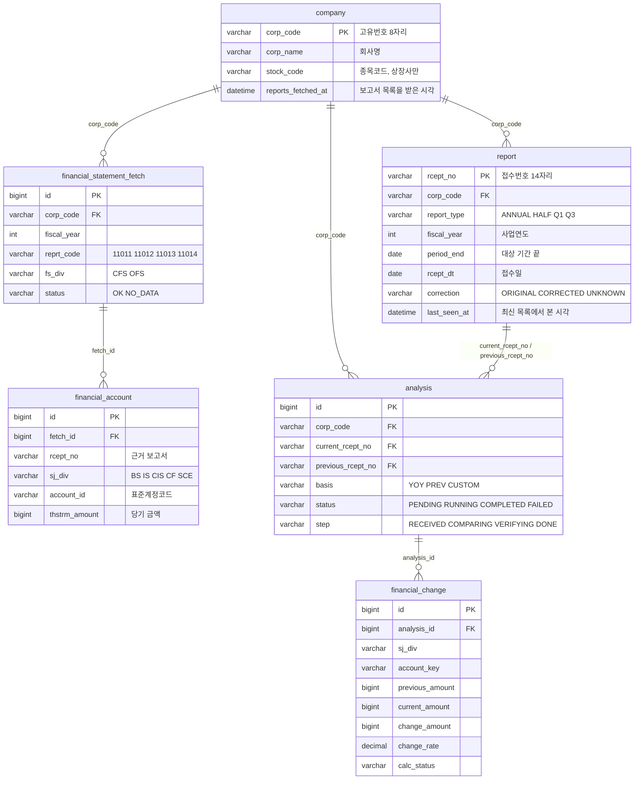

# ERD

> 스키마를 바꾸는 PR(Flyway 마이그레이션 추가)에서 이 문서도 함께 고칩니다. 문서와 마이그레이션 파일이 다르면 마이그레이션 파일(`backend/src/main/resources/db/migration`)이 기준입니다.

## 문서 정보

| 항목 | 내용 |
| --- | --- |
| 상태 | 초안 (M1 범위 확정, M2 범위는 자리만 잡음) |
| 담당 | 백엔드 |
| 마지막 수정 | 2026-10-21 |
| 관련 문서 | API 명세(`docs/api-spec.md`), [OpenDART 데이터 가이드](https://app.notion.com/p/400b6afffc6f81cc8870ee13d02d8ac1), 이슈 #46 |

## 1. 테이블 목록

| 테이블 | 설명 | 만드는 이슈 | 마일스톤 |
| --- | --- | --- | --- |
| `company` | 기업. OpenDART 고유번호 기준 | 4.4 (#51) | M1 |
| `report` | 정기보고서. 접수번호 기준 | 4.1 (#27) | M1 |
| `financial_statement_fetch` | 재무제표 API를 부른 기록(보고서·연결/별도 단위) | 4.5 (#52) | M1 |
| `financial_account` | 재무제표 계정 값(API 응답 한 줄) | 4.5 (#52) | M1 |
| `analysis` | 분석 작업과 상태 | 4.3 (#29), 2.3 (#14) | M1 |
| `financial_change` | 계정별 비교 결과와 근거 | 2.4 (#15), 4.3 (#29) | M1 |
| `document_section` 외 | 원문 구조·문장 변화·요약 | 4.2, 2.5, 3.2 | M2 (5절에 자리만) |

## 2. 관계도

## 3. 테이블 상세

공통: 문자열 키는 `VARCHAR`(앞자리 0을 지키기 위해 숫자형을 쓰지 않음), 금액은 원 단위 `BIGINT`, 시각은 `DATETIME(6)`(한국 시간), 상태 값은 `VARCHAR`에 영문 대문자로 저장합니다.

### company

OpenDART `corpCode.xml`에서 받습니다(4.4).

| 컬럼 | 타입 | 키 | null | 설명 |
| --- | --- | --- | --- | --- |
| `corp_code` | VARCHAR(8) | PK | 아니오 | 고유번호 |
| `corp_name` | VARCHAR(200) | | 아니오 | 회사명 |
| `corp_eng_name` | VARCHAR(200) | | 예 | 영문 회사명 |
| `stock_code` | VARCHAR(6) | | 예 | 종목코드. 비상장사는 null |
| `modify_date` | DATE | | 예 | OpenDART 최종 변경일 |
| `reports_fetched_at` | DATETIME(6) | | 예 | 정기보고서 목록을 마지막으로 받은 시각(4.1). null이면 아직 안 받음 |
| `created_at` | DATETIME(6) | | 아니오 | |
| `updated_at` | DATETIME(6) | | 아니오 | |

### report

OpenDART 공시검색(`list.json`, 정기공시 중 최종보고서만)에서 받습니다(4.1). 사업·반기·분기보고서 가운데 12월 결산 회사의 보고서만 저장하고, 나머지 정기공시는 건너뜁니다(잠정안).

정정되어 최신 목록에서 빠진 보고서는 지우지 않습니다(이미 분석에 쓰였을 수 있음). 목록을 받을 때마다 받은 보고서의 `last_seen_at`을 그 시각으로 바꾸고, 화면에는 `last_seen_at >= company.reports_fetched_at`인 보고서만 보여 줍니다.

| 컬럼 | 타입 | 키 | null | 설명 |
| --- | --- | --- | --- | --- |
| `rcept_no` | VARCHAR(14) | PK | 아니오 | 접수번호 |
| `corp_code` | VARCHAR(8) | FK | 아니오 | 고유번호 |
| `report_name` | VARCHAR(200) | | 아니오 | 보고서명 원문(`report_nm`) |
| `report_type` | VARCHAR(10) | | 아니오 | `ANNUAL` 사업, `HALF` 반기, `Q1` 1분기, `Q3` 3분기 |
| `fiscal_year` | INT | | 아니오 | 사업연도 |
| `period_end` | DATE | | 아니오 | 대상 기간의 끝(보고서명의 `(2026.06)` → 2026-06-30) |
| `rcept_dt` | DATE | | 아니오 | 접수일 |
| `correction` | VARCHAR(10) | | 아니오 | `ORIGINAL` 원본, `CORRECTED` 정정(보고서명 앞머리에 '정정'), `UNKNOWN` 확인 안 됨(앞머리는 없는데 비고에 '정'. '제출 뒤 정정신고가 있었다'는 뜻이라 추정하지 않음) |
| `remark` | VARCHAR(20) | | 예 | 비고(`rm`) 원문 |
| `filer_name` | VARCHAR(200) | | 예 | 공시 제출인 |
| `last_seen_at` | DATETIME(6) | | 아니오 | OpenDART 최신 목록에서 마지막으로 본 시각 |
| `created_at`, `updated_at` | DATETIME(6) | | 아니오 | |

### financial_statement_fetch

재무제표 API(`fnlttSinglAcntAll.json`)를 한 번 부른 결과입니다. 같은 조합(`uk_fs_fetch`)은 다시 부르지 않습니다(4.5). `013`(자료 없음)도 `NO_DATA`로 저장하고, 호출 실패(한도 초과·네트워크 오류)는 저장하지 않습니다. 2015 사업연도 이전은 API가 제공하지 않아 부르지 않습니다.

API는 사업연도·보고서 코드마다 최신 공시 하나의 값만 줍니다. 그래서 저장된 결과가 그 보고서의 자료가 아니면(`NO_DATA`이거나 `rcept_no`가 다름), 그 뒤에 보고서 목록에서 그 보고서를 다시 봤을 때(`report.last_seen_at > fetched_at`, 정정 공시가 새로 나왔거나 하루가 지나 목록을 다시 받았을 때) 한 번 더 받아 이 행과 계정 값을 바꿉니다.

| 컬럼 | 타입 | 키 | null | 설명 |
| --- | --- | --- | --- | --- |
| `id` | BIGINT | PK | 아니오 | 자동 증가 |
| `corp_code` | VARCHAR(8) | UK, FK | 아니오 | `company.corp_code` |
| `fiscal_year` | INT | UK | 아니오 | 사업연도(`bsns_year`) |
| `reprt_code` | VARCHAR(5) | UK | 아니오 | 11011 사업, 11012 반기, 11013 1분기, 11014 3분기 |
| `fs_div` | VARCHAR(3) | UK | 아니오 | `CFS` 연결, `OFS` 별도 |
| `status` | VARCHAR(10) | | 아니오 | `OK` 자료 있음, `NO_DATA` 자료 없음(013) |
| `rcept_no` | VARCHAR(14) | | 예 | 응답에 담긴 접수번호 |
| `fetched_at` | DATETIME(6) | | 아니오 | |

### financial_account

| 컬럼 | 타입 | 키 | null | 설명 |
| --- | --- | --- | --- | --- |
| `id` | BIGINT | PK | 아니오 | 자동 증가 |
| `fetch_id` | BIGINT | FK | 아니오 | `financial_statement_fetch.id` |
| `rcept_no` | VARCHAR(14) | | 아니오 | 근거 보고서 접수번호 |
| `sj_div` | VARCHAR(5) | | 아니오 | `BS` `IS` `CIS` `CF` `SCE` |
| `sj_name` | VARCHAR(100) | | 예 | 재무제표명 |
| `account_id` | VARCHAR(200) | | 아니오 | 표준계정코드. 없으면 `-표준계정코드 미사용-` |
| `account_name` | VARCHAR(200) | | 아니오 | 계정명 |
| `account_detail` | VARCHAR(500) | | 예 | 계정 상세(자본변동표). 응답이 `-`이면 null |
| `ord` | INT | | 예 | 원문 순서 |
| `currency` | VARCHAR(10) | | 예 | 통화 |
| `thstrm_name`, `frmtrm_name` | VARCHAR(50) | | 예 | 당기·전기 이름(예: 제 57 기 반기) |
| `thstrm_amount` | BIGINT | | 예 | 당기 금액. 분·반기 손익은 3개월 |
| `thstrm_add_amount` | BIGINT | | 예 | 당기 누적 금액(분·반기 손익) |
| `frmtrm_amount` | BIGINT | | 예 | 전기 금액(재무상태표는 전기말) |
| `frmtrm_q_amount` | BIGINT | | 예 | 전기 동기 3개월 |
| `frmtrm_add_amount` | BIGINT | | 예 | 전기 동기 누적 |

금액은 응답 문자열에서 쉼표를 빼고 원 단위 정수로 저장합니다. 빈 값과 `-`는 null입니다(0과 구분).

### analysis

| 컬럼 | 타입 | 키 | null | 설명 |
| --- | --- | --- | --- | --- |
| `id` | BIGINT | PK | 아니오 | 분석 ID |
| `corp_code` | VARCHAR(8) | FK | 아니오 | `company.corp_code` |
| `current_rcept_no` | VARCHAR(14) | FK | 아니오 | 현재 보고서(`report.rcept_no`) |
| `previous_rcept_no` | VARCHAR(14) | FK | 아니오 | 비교(이전) 보고서(`report.rcept_no`) |
| `basis` | VARCHAR(10) | | 아니오 | `YOY` 전년 동기, `PREV` 직전 기간, `CUSTOM` 직접 선택 |
| `analysis_version` | VARCHAR(20) | | 아니오 | 계산 규칙 버전. 규칙이 바뀌면 올려서 옛 결과와 섞지 않음 |
| `fs_div` | VARCHAR(3) | | 예 | 비교에 쓴 기준(연결·별도) |
| `status` | VARCHAR(10) | | 아니오 | `PENDING` `RUNNING` `COMPLETED` `FAILED` |
| `step` | VARCHAR(20) | | 아니오 | `RECEIVED` 요청 접수, `COMPARING` 보고서 비교, `VERIFYING` 근거 확인, `DONE` 완료 |
| `error_code` | VARCHAR(50) | | 예 | 실패 사유 코드 |
| `error_message` | VARCHAR(500) | | 예 | 실패 사유 |
| `request_trace_id` | VARCHAR(64) | | 예 | 분석을 요청한 요청의 추적 ID(`X-Trace-Id`) |
| `created_at`, `updated_at` | DATETIME(6) | | 아니오 | |
| `started_at`, `completed_at` | DATETIME(6) | | 예 | |

### financial_change

| 컬럼 | 타입 | 키 | null | 설명 |
| --- | --- | --- | --- | --- |
| `id` | BIGINT | PK | 아니오 | |
| `analysis_id` | BIGINT | FK | 아니오 | `analysis.id` |
| `sj_div` | VARCHAR(5) | | 아니오 | 재무제표 종류 |
| `fs_div` | VARCHAR(3) | | 아니오 | 연결·별도 |
| `account_key` | VARCHAR(200) | | 아니오 | 두 보고서의 계정을 맞춘 키(표준계정코드, 없으면 정규화한 계정명) |
| `account_name` | VARCHAR(200) | | 아니오 | 현재 보고서의 계정명 |
| `display_order` | INT | | 아니오 | 화면 정렬 순서 |
| `amount_basis` | VARCHAR(10) | | 아니오 | `POINT` 시점(재무상태표), `CUMULATIVE` 누적, `QUARTER` 3개월 |
| `previous_amount` | BIGINT | | 예 | 이전 값 |
| `current_amount` | BIGINT | | 예 | 현재 값 |
| `change_amount` | BIGINT | | 예 | 현재 값 − 이전 값 |
| `change_rate` | DECIMAL(20,6) | | 예 | 증감률(비율, 0.153 = 15.3%) |
| `calc_status` | VARCHAR(20) | | 아니오 | 계산 상태(아래) |
| `previous_rcept_no`, `current_rcept_no` | VARCHAR(14) | | 예 | 근거 보고서 |
| `previous_account_id`, `current_account_id` | VARCHAR(200) | | 예 | 근거 계정 |
| `previous_period_name`, `current_period_name` | VARCHAR(50) | | 예 | 근거 기간 이름 |

`calc_status`: `OK`, `PREVIOUS_ZERO`(이전 값 0), `PREVIOUS_NEGATIVE`(이전 값 음수), `PREVIOUS_MISSING`(이전 값 미기재), `CURRENT_MISSING`(현재 값 미기재), `ONLY_CURRENT`(현재 보고서에만 있음), `ONLY_PREVIOUS`(이전 보고서에만 있음), `AMBIGUOUS_MATCH`(같은 계정이 여러 개이고 두 보고서의 개수가 달라 짝을 확정하지 못함, 검토 필요), `PERIOD_MISMATCH`(기간이 달라 계산하지 않음).

## 4. 인덱스·제약

| 테이블 | 이름 | 컬럼 | 종류 | 이유 |
| --- | --- | --- | --- | --- |
| `company` | `idx_company_corp_name` | `corp_name` | 인덱스 | 회사명 정렬·완전 일치. 부분 일치 검색(`%검색어%`)에는 쓰이지 않음 |
| `company` | `idx_company_stock_code` | `stock_code` | 인덱스 | 종목코드 검색 |
| `report` | `idx_report_corp_period` | `corp_code, period_end` | 인덱스 | 기업별 보고서 목록 |
| `financial_statement_fetch` | `uk_fs_fetch` | `corp_code, fiscal_year, reprt_code, fs_div` | 유니크 | 같은 호출을 두 번 저장하지 않음 |
| `financial_account` | `idx_fin_account_fetch` | `fetch_id, sj_div, ord` | 인덱스 | 재무제표별 계정을 원문 순서로 조회 |
| `analysis` | `idx_analysis_key` | `corp_code, current_rcept_no, previous_rcept_no, basis, analysis_version` | 인덱스 | 같은 조건 결과 재사용(4.3) |
| `financial_change` | `idx_fin_change_analysis` | `analysis_id, sj_div` | 인덱스 | 결과 화면 조회 |

## 5. M2에서 더할 테이블 (자리만)

원문 파싱(4.2)과 문장 변경 탐지(2.5), 요약(3.2)을 만들 때 확정합니다.

| 테이블 | 담을 것 |
| --- | --- |
| `document_section` | 보고서별 목차(섹션)와 위치 |
| `document_block` | 섹션 안의 문단·표와 위치(접수번호·섹션·문단 번호) |
| `text_change` | 두 보고서의 문단 대응, 추가·삭제·수정·검토 필요, 우선순위 |
| `summary_item` | 요약 문장, 근거 ID, 모델·프롬프트 버전, AI 생성 표시 |

## 6. 작성 규칙

- 테이블·컬럼 이름은 snake_case입니다.
- 금액은 원 단위 정수(BIGINT)로 저장합니다. OpenDART 재무제표 API는 원 단위로 줍니다.
- 없는 값은 NULL로 두고 0과 구분합니다.
- 회사 키는 `corp_code`, 보고서 키는 `rcept_no`입니다. 종목코드는 키로 쓰지 않습니다.
- 스키마는 Flyway 마이그레이션 파일(`V{번호}__{설명}.sql`)로만 바꿉니다. main에 병합된 파일은 고치지 않고 새 파일을 추가합니다.
- 상태 값 컬럼은 `VARCHAR`로 두고 MariaDB `ENUM`을 쓰지 않습니다(값을 더할 때 스키마 변경이 필요 없게).
