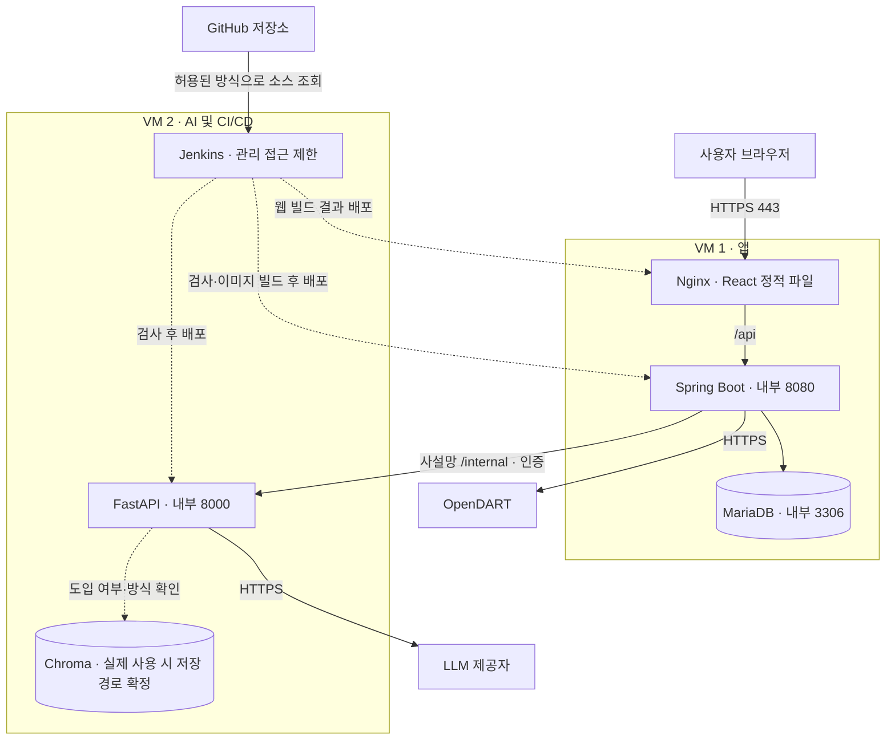

# Dart Insight 서버 배치 아키텍처

- 작성: 2026-10-29
- 담당: @yeeun7k
- 관련: #120 / [ADR-0043](../adr/0043-two-vm-jenkins-deployment.md)
- 상태: 팀이 정한 역할 배치를 문서화한 검토안. 실제 설치·배포·보안·성능 검증 완료를 의미하지 않는다.

## 구성도

점선 Chroma는 실행이 확인된 구성 요소가 아니라 적용 확인 대상이다. Jenkins 화살표는 배포 제어 흐름이며 사용자 요청 흐름이 아니다. 서로 다른 VM의 Compose 네트워크는 자동 연결되지 않으므로 VM 간 경로와 접근 정책을 따로 설정한다.

## 역할과 근거

| 위치 | 역할 | 근거·한계 |
| --- | --- | --- |
| VM1 | Nginx·React·Spring Boot·MariaDB | 일반 조회와 데이터 저장을 AI 실행 환경에서 분리한다. VM1 자체 장애를 대신할 서버는 없다. |
| VM2 | FastAPI·Jenkins | 제한된 VM 수에서 AI와 배포를 담당한다. 빌드와 AI가 CPU·메모리·디스크를 경쟁하므로 동시 빌드와 보존 정책을 제한한다. |
| 미정 | Prometheus·Grafana, Chroma 저장 방식 | 실제 자원·코드 사용 여부를 확인한 뒤 #126·#489·#123에서 확정한다. |

VM은 가상 머신으로, 운영체제와 할당 자원을 분리하는 실행 환경이다. 두 VM 사용 목적은 자원 경합과 장애 영향 범위의 축소이며, 서비스 복제나 고가용성(장애 시 다른 인스턴스가 서비스를 이어받는 구성)을 제공하지 않는다.

## 통신과 보안

- 외부 서비스 진입점은 HTTPS 443의 Nginx다. 리버스 프록시는 외부 요청을 받아 내부 서버로 전달하는 역할이다.
- React는 Spring Boot만 호출한다. OpenDART 조회·캐시는 backend가 담당하고 FastAPI는 내부 입력을 처리한다. [ADR-0002](../adr/0002-monorepo-and-call-direction.md)의 책임을 유지한다.
- 8080·8000·3306 및 Jenkins·모니터링 관리 포트를 인터넷에 직접 공개하지 않는다.
- VM1에서 VM2로 필요한 내부 호출만 허용하고 실제 내부 인증·시간 제한 설정을 검증한다.
- 서버 관리 접속과 Jenkins의 배포 경로는 승인된 관리망을 사용한다. 외부 22·80 포트 개방을 전제하지 않는다.
- 키·비밀번호·실제 접속 정보는 이 문서나 공개 이슈에 넣지 않는다.

## 배포와 저장

서버는 Docker Compose를 사용하고 개인 PC는 #114의 MariaDB 직접 설치 방침을 유지한다. CI는 소스를 검사하고 빌드하는 단계, CD는 검사를 통과한 버전을 서버에 배포하는 단계다. 목표 CI/CD 도구는 Jenkins이며 기존 GitHub Actions 검사 제거는 팀 확인 없이 실행하지 않는다.

Jenkins 설치(#125), 검사·이미지 빌드(#487), VM별 배포·이전 버전 복구(#488)는 별도 작업이다. 이미지는 커밋 SHA로 식별하고 상태 확인 실패 시 배포를 실패로 처리한다. DB 변경이 이전 앱과 호환되지 않으면 이미지 복구만으로 되돌릴 수 없으므로 제한을 기록한다.

MariaDB 데이터를 영속 볼륨으로 보존한다. 영속성은 재시작 후 데이터가 유지되는 성질이며, 별도 백업을 대신하지 않는다. 백업 복원은 #490에서 원본과 분리된 대상으로 검증한다. Chroma 미사용 시 불필요한 서버를 추가하지 않는다.

## 남은 검증

| 작업 | 이슈 |
| --- | --- |
| 실제 VM 사양·관리 경로·사설 통신 확인 | #119 |
| 서버 Compose와 영속 저장 | #121 |
| 앱·AI 배포 및 내부 연동 | #122, #123, #124 |
| Jenkins 설치·빌드·배포 | #125, #487, #488 |
| 지표 수집·대시보드 배치 | #126, #489 |
| 인증서·외부 포트 차단 검증 | #127 |
| 백업 복원·통합 인수 | #490, #128 |
| 일반 API·분석 접수·Jenkins 경합 측정 | #129 |

RAM 8GB·디스크 30GB 등 기존 대화의 추정 사양은 확정값으로 쓰지 않는다. 별도 LangGraph Worker·Redis·Kubernetes 추가는 현재 배포 범위에 포함하지 않는다.
