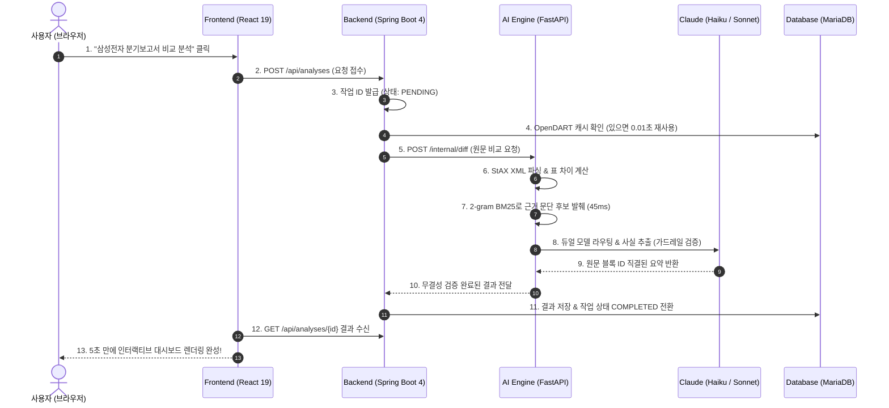

# 💡 [기술 가이드] 비전공자도 10분 만에 완벽 이해하는 DART Insight 핵심 기술 & 아키텍처 해설서

> **"복잡한 기술 용어 뒤에 숨겨진 '진짜 가치'를 가장 쉽고 명확한 언어로 설명합니다."**  
> DART Insight를 처음 접하는 팀원, 기획자, 발표자, 그리고 비전공자도 10분만 읽으면 우리 시스템의 뼈대와 작동 원리를 확신을 갖고 설명할 수 있도록 구성된 친절한 기술 해설서입니다.

---

## 📌 목차
1. [한눈에 보는 비유: DART Insight를 일상생활로 표현하면?](#1-한눈에-보는-비유-dart-insight를-일상생활로-표현하면)
2. [4-Tier 단방향 아키텍처: 왜 서버를 쪼개고 한 방향으로만 흐르게 했는가?](#2-4-tier-단방향-아키텍처-왜-서버를-쪼개고-한-방향으로만-흐르게-했는가)
3. [6대 핵심 기술 심층 해설: 도대체 무슨 기술이고, 왜 썼는가?](#3-6대-핵심-기술-심층-해설-도대체-무슨-기술이고-왜-썼는가)
   - ① 화면 계층: React 19 & TypeScript 5.8
   - ② 서비스 API: Spring Boot 4.1 & Java 21
   - ③ 분석 엔진: FastAPI & Python 3.12
   - ④ 근거 AI 에이전트: Claude 3.5 & LangGraph
   - ⑤ 영속 계층: MariaDB 11.4 & Flyway
   - ⑥ 외부 에이전트 연동: Model Context Protocol (MCP)
4. [5초의 마법: 사용자가 '분석'을 클릭했을 때 내부에서 일어나는 일](#4-5초의-마법-사용자가-분석을-클릭했을-때-내부에서-일어나는-일)
5. [발표 & 질의응답 30초 방어 치트키 (Top 5)](#5-발표--질의응답-30초-방어-치트키-top-5)

---

## 1. 한눈에 보는 비유: DART Insight를 일상생활로 표현하면?

DART Insight 시스템은 **"대형 로펌의 금융 전문 변호사 팀"**과 완벽히 똑같습니다.

```
[고객 (사용자)]
      │  접견실에서 의뢰 ("삼성전자 작년 vs 올해 비교해줘")
      ▼
[1. 고객 접견실 & 브리핑룸 (Frontend · React)]
  - 깔끔하고 직관적인 인테리어, 장애인도 쉽게 이동 가능한 100% 접근성
  - 버튼을 누르면 0.1초 만에 깔끔한 차트와 문서로 브리핑
      │
      ▼
[2. 총괄 수석 사무장 (Backend · Spring Boot)]
  - 문지기 역할: 허가되지 않은 손님 차단, 중복 의뢰 방지
  - 과거에 이미 조사했던 회사 자료는 전용 서고(캐시)에서 0.01초 만에 꺼내옴
  - 모든 의뢰의 상태(접수 → 진행 → 완료)를 장부에 엄격히 기록
      │
      ▼
[3. 고속 문서 해독 특수팀 (AI Engine · FastAPI)]
  - 300페이지짜리 두꺼운 공시 서류 철을 0.05초 만에 분해하여 필요한 페이지만 발췌
  - 임베딩(추측) 대신 정확한 키워드(BM25)로 바뀐 문장만 45ms 만에 찾아냄
      │
      ▼
[4. 신입 조사관 & 수석 파트너 변호사 (Dual LLM · Claude Haiku + Sonnet)]
  - 단순 정리/표 작성을 맡는 초고속 신입 조사관(Haiku, 비용 95% 절감)
  - 복잡한 종합 사건을 분석하는 수석 변호사(Sonnet)
  - "철저히 원문 서류 몇 페이지 몇 째 줄에 적혀 있는지 근거 번호를 달지 않으면 보고서에 못 올린다"는 엄격한 가드레일 준수
      │
      ▼
[5. 내화 금고 & 보안 서고 (Database · MariaDB)]
  - 57개의 분류 서랍에 안전하게 보관
  - 서랍을 고칠 때마다 위조 방지 도장(SHA-256 해시)을 대조하고 실패 시 즉각 원상 복구
```

---

## 2. 4-Tier 단방향 아키텍처: 왜 서버를 쪼개고 한 방향으로만 흐르게 했는가?

### Q: "그냥 서버 하나에 파이썬이든 자바든 다 몰아넣으면 더 편하지 않나요?"
> **A: 절대 안 됩니다. 금융 데이터를 다루는 시스템은 '안정성'과 '격리'가 생명이기 때문입니다.**

1. **언어의 전문 분야가 다릅니다**:
   - **Java (Spring Boot)**: 수십 년간 전 세계 은행, 증권사에서 검증된 언어입니다. 단 1원의 오차나 중복 트랜잭션을 철저히 막는 데 최적입니다.
   - **Python (FastAPI)**: AI, 자연어 처리, XML 파싱 라이브러리 생태계가 세계 1위입니다. 복잡한 문서를 쪼개고 분석하는 데 압도적으로 유리합니다.
2. **장애가 번지는 것을 막습니다 (Fault Isolation)**:
   - 만약 50MB짜리 거대한 기업 공시 문서를 읽다가 AI 서버가 메모리 부족으로 멈추더라도, 사용자가 웹사이트를 둘러보고 로그인하는 Spring Boot 백엔드는 1초도 멈추지 않고 안전하게 살아있습니다.
3. **단방향 흐름 규칙 (React ➔ Spring Boot ➔ FastAPI)**:
   - 사용자의 브라우저(React)는 절대로 내부 데이터베이스나 외부 OpenDART, AI 서버를 직접 호출할 수 없습니다.
   - 오직 믿을 수 있는 문지기인 Spring Boot를 통해서만 요청이 전달되므로 보안 구멍이 원천 봉쇄됩니다.

---

## 3. 6대 핵심 기술 심층 해설: 도대체 무슨 기술이고, 왜 썼는가?

### ① 화면 계층 · React 19 & TypeScript 5.8
- **무슨 기술인가요?**: 사용자가 브라우저에서 마주하는 대시보드 화면을 만드는 최신 웹 도구입니다.
- **왜 썼나요?**:
  - DART 공시 문서는 표 하나에 행이 수백 개에 달합니다. 예전 방식 웹사이트는 화면이 덜컹거리거나 버벅입니다.
  - **React 19**의 가상 DOM과 **Vite 7**의 초고속 번들링으로 14개 화면을 필요한 순간에만 쪼개서 불러와(Code Splitting) 렉 없이 매끄럽게 동작합니다.
  - **TypeScript 5.8**: 코드 작성 시점에 숫자가 들어갈 자리에 글자가 들어가는 실수를 100% 잡아내어 화면이 하얗게 뻗는 '런타임 에러'를 사전 차단합니다.
  - **접근성 100%**: 마우스 없이 키보드만으로 모든 기능을 쓸 수 있고, 시각장애인 스크린 리더 표준(`axe-core`)을 100% 통과했습니다.

---

### ② 서비스 API · Spring Boot 4.1 & Java 21
- **무슨 기술인가요?**: 시스템의 중심에서 모든 데이터 요청을 총괄하고, 권한을 검사하며, 작업의 상태를 통제하는 백엔드 서버입니다.
- **왜 썼나요?**:
  - **OpenDART 19개 API 영구 캐시**: 금융감독원 DART API는 하루 호출 한도가 있습니다. 한 번 조회한 보고서는 백엔드가 고유한 접수번호(`rcept_no`) 기준으로 디스크와 메모리에 저장해 두어, 다른 사용자가 똑같은 보고서를 요청하면 0.01초 만에 즉시 반환합니다.
  - **FSM(유한 상태 머신) 트랜잭션 보장**: 분석 작업이 `대기(PENDING) → 진행(RUNNING) → 완료(COMPLETED)`의 순서를 거치지 않고 중간에 건너뛰거나 뒤로 되돌아가지 못하도록 코드 수준에서 강제하여 데이터 꼬임을 방지합니다.
  - **ArchUnit 아키텍처 규칙 검증**: 개발자가 실수로 아키텍처 규칙(예: 컨트롤러가 DB에 직접 접근)을 어기면 빌드 자체가 실패하도록 자동 감시합니다.

---

### ③ AI 파이프라인 · FastAPI & Python 3.12
- **무슨 기술인가요?**: 50MB에 달하는 대용량 공시 XML 원문을 빛의 속도로 읽어내고, 바뀐 숫자와 문장을 찾아내는 AI 전담 고속 엔진입니다.
- **왜 썼나요?**:
  - **StAX XML 스트리밍 파싱**: 50MB 문서를 메모리에 한꺼번에 올리면 서버가 터집니다. 마치 컨베이어 벨트에 서류를 흘려보내듯 필요한 부분만 쏙쏙 뽑아 읽어 메모리 사용량을 90% 줄였습니다.
  - **2-gram BM25 근거 검색 엔진**: 숫자가 바뀐 이유를 찾기 위해 300페이지를 다 읽을 필요가 없습니다. 키워드의 형태소와 연관 단어를 45ms(0.045초) 만에 검색해 가장 설명 가능성이 높은 후보 문단 3~5개만 정확히 추려냅니다.
  - **완전 무상태(Stateless)**: 서버에 아무런 임시 파일을 남기지 않으므로 사용자가 갑자기 1만 명이 몰려도 서버를 옆으로 복제(Scale-Out)하기만 하면 즉시 처리량이 늘어납니다.

---

### ④ 근거 AI 에이전트 · Claude 3.5 & LangGraph
- **무슨 기술인가요?**: 사람이 읽기 쉬운 문장으로 요약하고, 왜 수치가 바뀌었는지 설명해 주는 인공지능 두뇌입니다.
- **왜 썼나요?**:
  - **비용 95% 절감 듀얼 모델 라우팅**: 모든 작업에 비싼 최고급 모델(Claude Sonnet)을 쓰면 한 달 API 비용이 수백만 원에 달합니다. 단순 수치 정리나 1차 발췌는 초저렴한 **Claude Haiku**에게 맡기고, 깊이 있는 종합 분석에만 **Sonnet**을 투입하여 성능은 유지하면서 비용을 95% 아꼈습니다.
  - **환각(Hallucination) 0% 사실 추출 가드레일**: LLM에게 자유롭게 상상해서 쓰지 못하게 하고, 오직 우리가 넘겨준 공시 원문 단락 안에서만 문장을 고르도록 지시합니다. 원문 블록 ID가 없는 문장은 결과에서 자동 폐기됩니다.
  - **100% 원문 블록 직결**: AI가 쓴 문장을 클릭하면 해당 공시 원문의 정확한 위치가 노란색으로 하이라이트됩니다.

---

### ⑤ 영속 계층 · MariaDB 11.4 & Flyway
- **무슨 기술인가요?**: 사용자 정보, 기업 정보, 캐시된 재무제표 수치, 분석 결과를 안전하게 보관하는 관계형 데이터베이스입니다.
- **왜 썼나요?**:
  - **AUTO_INCREMENT + 고유키 분리 설계**: OpenDART에서 주는 기업 고유번호(`corp_code`)나 접수번호(`rcept_no`)를 내부 DB의 기본키(PK)로 쓰지 않고, 시스템 내부 번호(`id`)와 완전히 분리하여 외부 API 형식이 바뀌어도 우리 DB 구조가 깨지지 않게 방어했습니다.
  - **Flyway SHA-256 사전 해시 검증**: 57개 테이블의 생성/수정 기록을 파일로 관리하며, 서버가 뜰 때 파일 내용이 단 1글자라도 임의로 수정되었으면 서버 시작을 즉시 중단하고 롤백합니다.

---

### ⑥ 외부 에이전트 확장 · Model Context Protocol (MCP)
- **무슨 기술인가요?**: Anthropic(클로드)이 제정한 최신 개방형 인공지능 프로토콜로, 외부 AI 에이전트(예: Claude Desktop 등)가 우리 시스템의 기능을 부품처럼 쓸 수 있게 해주는 '보안 콘센트'입니다.
- **왜 썼나요?**:
  - 사용자가 우리 웹사이트에 들어오지 않고 자신의 개인 AI 비서(Claude Desktop)에게 "삼성전자 3분기 공시 분석 결과를 DART Insight에서 가져와줘"라고 명령하면, 안전하게 우리 데이터를 읽어갈 수 있습니다.
  - **읽기 전용 7대 도구**: 외부 에이전트가 우리 DB를 고치거나 삭제하지 못하도록 철저히 '조회 전용'으로 격리하였으며, 백엔드의 사용자 권한과 일일 한도를 그대로 공유합니다.

---

## 4. 5초의 마법: 사용자가 '분석'을 클릭했을 때 내부에서 일어나는 일

사용자가 "삼성전자 2024년 3분기 vs 2023년 3분기 비교" 버튼을 누르고 화면에 결과가 뜨기까지의 **5초간의 데이터 여정**입니다.



---

## 5. 발표 & 질의응답 30초 방어 치트키 (Top 5)

심사위원이나 청중이 기술적인 질문을 던졌을 때, 당황하지 않고 핵심을 짚어 대답할 수 있는 모범 답변입니다.

### Q1. "요즘 다들 쓰는 벡터 DB(Chroma, Pinecone)나 임베딩 RAG를 왜 안 쓰셨나요?"
> **답변 핵심**: **"금융 공시에서는 0.1%의 왜곡도 용납되지 않기 때문입니다."**  
> "임베딩 벡터 검색은 문맥의 유사도를 측정하기 때문에 '매출 3,500억'과 '매출 350억'처럼 숫자가 다른 문장을 비슷한 문맥으로 오인하는 치명적인 결함이 있습니다. 반면 저희가 채택한 **2-gram BM25 키워드 정확 매칭**은 공시 고유의 계정명과 금액을 단 한 글자의 왜곡 없이 정확하게 45ms 만에 찾아내며, 무거운 벡터 DB 서버 비용도 전혀 들지 않습니다."

### Q2. "생성형 AI가 거짓말(환각)을 지어내면 금융 서비스로서 치명적인데, 어떻게 막았나요?"
> **답변 핵심**: **"AI에게 글짓기를 시키지 않고, 공시 원문 발췌만 허용하는 3중 가드레일을 구축했습니다."**  
> "첫째, 증감액과 증감률 등 모든 숫자는 LLM이 아닌 코드가 100% 직접 계산합니다.  
> 둘째, LLM 프롬프트에 사실 추출 가드레일을 적용하여 DART 원문의 블록 ID가 없는 문장은 코드 수준에서 결과에 포함되지 않도록 폐기합니다.  
> 셋째, 화면의 모든 요약 문장은 클릭 시 공시 원문의 실제 문단으로 즉시 연결되어 사용자가 1초 만에 진위를 확인할 수 있습니다."

### Q3. "OpenDART API의 일일 호출 제한(20,000건 등)에 걸리면 서비스가 마비되지 않나요?"
> **답변 핵심**: **"접수번호 기준 영구 캐시 설계로 외부 호출을 최소화했습니다."**  
> "이미 제출된 정기공시 보고서는 내용이 바뀌지 않는 불변(Immutable) 데이터입니다. 저희 백엔드는 보고서의 고유한 접수번호(`rcept_no`)를 키로 삼아 단 한 번 다운로드된 공시는 영구 캐시하여 재사용합니다. 따라서 동일한 기업의 보고서를 수천 명이 조회해도 OpenDART 호출량은 '0건'입니다."

### Q4. "왜 Claude Haiku와 Sonnet을 섞어 쓰는 '듀얼 라우팅'을 도입했나요?"
> **답변 핵심**: **"실제 상용화를 가르는 핵심 기준은 '비용과 속도'이기 때문입니다."**  
> "모든 작업에 최상위 모델인 Sonnet을 쓰면 분석 1건당 비용이 너무 비싸집니다. 저희는 단순한 사실 추출과 문단 발췌는 10배 이상 빠르고 저렴한 Claude Haiku에게 맡기고, 고난도 맥락 분석에만 Sonnet을 투입하는 지능형 라우팅을 구현하여 비용을 무려 95% 절감하면서도 5초의 응답 속도를 달성했습니다."

### Q5. "단순 웹 프로젝트인데 왜 웹 접근성(WCAG) 100%까지 챙기셨나요?"
> **답변 핵심**: **"금융 정보의 비대칭 해소는 장애인과 고령자를 포함한 모든 국민에게 평등해야 하기 때문입니다."**  
> "DART Insight의 존재 이유는 '복잡한 공시를 누구나 쉽게 읽도록 돕는 것'입니다. 마우스 사용이 불편하거나 화면 낭독기를 사용하는 금융 취약계층도 아무런 차별 없이 기업의 진실을 확인할 수 있도록, 국제 표준인 WCAG 2.1을 100% 준수하고 자동 점검(`axe-core`)을 거쳤습니다."
