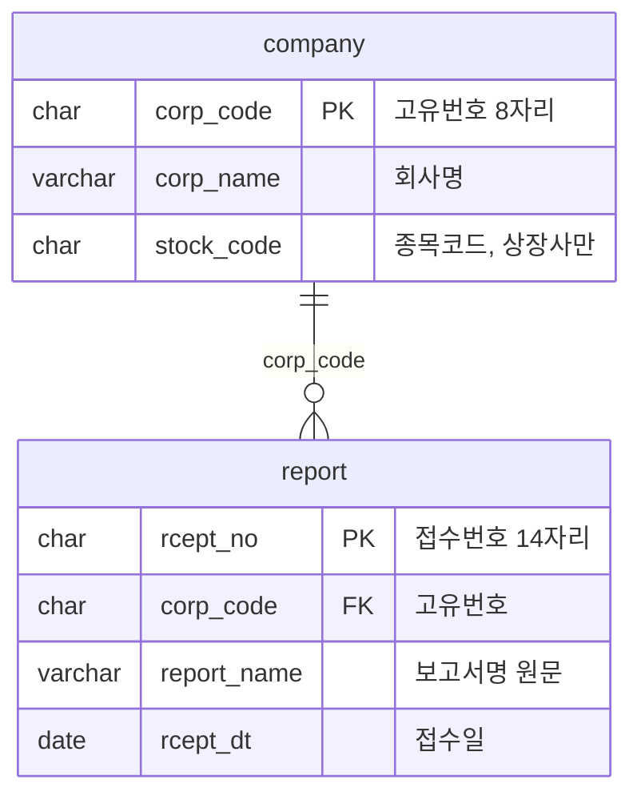

# ERD 템플릿

> 이 파일을 `docs/erd.md`로 복사해 씁니다. 스키마를 바꾸는 PR(Flyway 마이그레이션 추가)에서 이 문서도 함께 고칩니다. 문서와 마이그레이션 파일이 다르면 마이그레이션 파일이 기준입니다.
>
> 아래 `(예시)`는 쓰는 형식을 보여 주려고 넣은 것입니다. 실제 테이블은 담당자가 정해서 바꿉니다.

## 문서 정보

| 항목 | 내용 |
| --- | --- |
| 상태 | 초안 / 확정 |
| 담당 | |
| 마지막 수정 | YYYY-MM-DD |
| 관련 문서 | API 명세(`docs/api-spec.md`), [OpenDART 데이터 가이드](https://app.notion.com/p/400b6afffc6f81cc8870ee13d02d8ac1) |

## 1. 테이블 목록

| 테이블 | 설명 | 주로 쓰는 서비스 | 관련 이슈 |
| --- | --- | --- | --- |
| `company` (예시) | 기업. 고유번호 기준 | backend | #8 (1.1) |
| `report` (예시) | 정기보고서. 접수번호 기준 | backend | #9 (1.2) |
| | | | |

## 2. 관계도

## 3. 테이블 상세

테이블마다 아래 형식으로 한 절씩 씁니다.

### company (예시)

| 컬럼 | 타입 | 키 | null | 기본값 | 설명 |
| --- | --- | --- | --- | --- | --- |
| `corp_code` | CHAR(8) | PK | 아니오 | | OpenDART 고유번호. 앞자리 0을 지키도록 문자열 |
| `corp_name` | VARCHAR(100) | | 아니오 | | 회사명 |
| `stock_code` | CHAR(6) | | 예 | | 종목코드. 상장사에만 있음 |
| `created_at` | DATETIME | | 아니오 | CURRENT_TIMESTAMP | 저장 시각 |

## 4. 인덱스·제약

| 테이블 | 이름 | 컬럼 | 종류 | 이유 |
| --- | --- | --- | --- | --- |
| `report` (예시) | `idx_report_corp_code` | `corp_code` | 인덱스 | 기업별 보고서 목록 조회 |
| | | | | |

## 5. 작성 규칙

- 테이블·컬럼 이름은 snake_case입니다.
- 금액은 원 단위 정수(BIGINT)로 저장합니다. 원문 표의 단위(천원·백만원)와 변환 전 값은 근거로 함께 남깁니다.
- 없는 값은 NULL로 두고 0과 구분합니다.
- 회사 키는 `corp_code`, 보고서 키는 `rcept_no`입니다. 종목코드는 키로 쓰지 않습니다.
- 스키마는 Flyway 마이그레이션 파일(`V{번호}__{설명}.sql`)로만 바꿉니다. main에 병합된 파일은 고치지 않고 새 파일을 추가합니다.

## 6. 정하지 못한 것

| 질문 | 담당 | 기한 | 결정 로그 |
| --- | --- | --- | --- |
| | | | |
